# Request and approve Copilot Credits

The **Copilot Credits** tab in [Request Center](./REQUEST_CENTER.md) lets makers ask for Copilot Credits for their environments, and lets admins review and allocate those credits without leaving Copilot Agent Kit. When an admin approves a request, the app allocates the credits in the Power Platform admin center and verifies the result.

## In this article

- [Key concepts](#key-concepts)
- [Before you start](#before-you-start)
- [Maker workflow](#maker-workflow)
- [Admin workflow](#admin-workflow)
- [Request statuses](#request-statuses)
- [Troubleshooting](#troubleshooting)

## Key concepts

- **Copilot Credits**: The capacity that Copilot Studio agents use when they run. Admins allocate credits to an environment in the Power Platform admin center. For more information, see [Manage Copilot Studio costs](https://learn.microsoft.com/copilot/implement/usage-based-billing-manage-copilot-studio-costs).
- **Credits requested**: The number of credits the maker wants added to an environment. The minimum is 500.
- **Tenant draw**: The **Draw from the available capacity in my tenant** setting for an environment. When it's on, the environment can use your tenant's unassigned credits when its own credits run out, or if it has none.
- **One request per environment**: Each environment in a submission becomes its own request. An environment can have only one active credit request at a time.

> [!IMPORTANT]
> Copilot Credits requests work only for environments whose Copilot Credits are managed in the Power Platform admin center. If a Microsoft 365 admin center spending policy covers the environment, approval in Copilot Agent Kit doesn't apply. Reject the request and manage credits in the Microsoft 365 admin center instead. For more information, see [Manage Copilot Studio costs](https://learn.microsoft.com/copilot/implement/usage-based-billing-manage-copilot-studio-costs).

## Before you start

The Copilot Credits tab doesn't use any cloud flows. You don't need to run **PowerShield | Sync Connectors** or set up the Connector Requests connection references to use it.

### Makers

- The **CAK - Maker** or **System Administrator** security role.
- The connections that Copilot Agent Kit for Makers already uses: **Power Apps for Makers** and **Microsoft Dataverse**. No extra setup is needed.

### Admins

- The **CAK - Administrator** or **System Administrator** security role.
- The **Power Platform Administrator** role in Microsoft Entra ID. Approval allocates credits with your own account, so it fails without this role.
- Your own **Power Platform for Admins V2** connection. The first time you open Copilot Agent Kit for Admins, the app asks you to sign in to this connector. Complete the sign-in. Each admin creates their own connection, and connections aren't shared.

## Maker workflow

### Home screen (maker view)

In **Copilot Agent Kit for Makers**, go to **Governance** > **Request Center**, and then select the **Copilot Credits** tab.

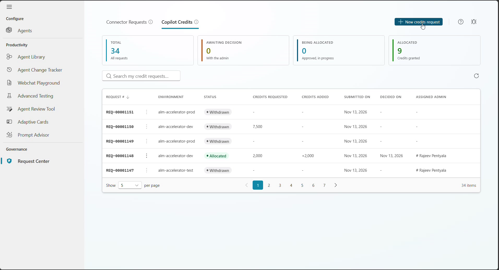

- **Stat cards**: **Total**, **Awaiting decision**, **Being allocated**, and **Allocated**. A **Needs your attention** card appears only when a request needs action. Select a card to filter the list.
- **Request list**: Shows **Request #**, **Environment**, **Status**, **Credits requested**, **Credits added**, **Submitted on**, **Decided on**, and **Assigned admin**. Select a row to open the request.
- **Row actions (⋮)**: **Resume draft**, **Request a change**, or **Withdraw**, depending on the request status.

### Create a credits request

Select **New credits request**. The wizard has four steps.

#### Step 1: Environments

Select one or more environments. Use the search box and the **All Types** and **All Locations** filters to find them.

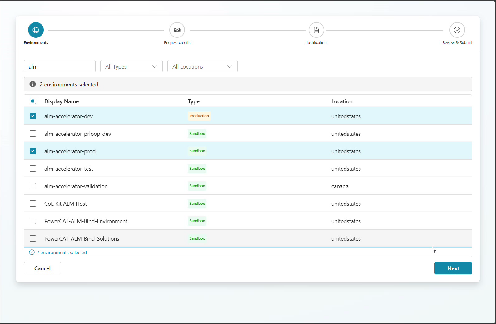

The list shows only environments you can access. If an environment already has an active credit request, the wizard flags it and skips it. Open the existing request instead.

#### Step 2: Request credits

For each environment, enter the **Credits requested**, select **Draw from tenant**, or do both.

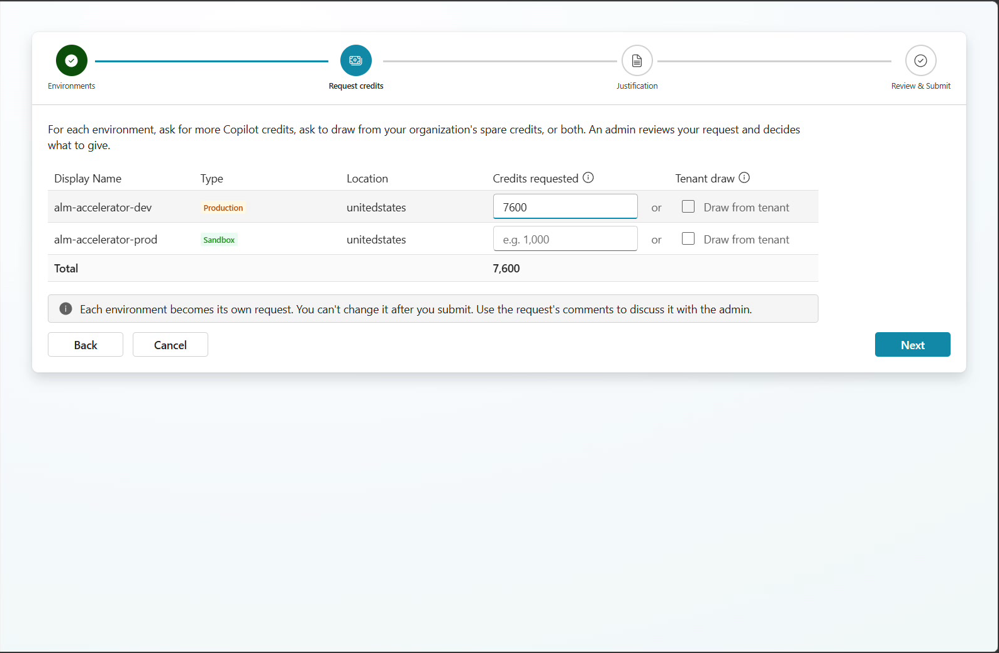

- **Credits requested** must be a whole number of at least 500.
- Each environment becomes its own request. You can't change it after you submit.

#### Step 3: Justification

Describe what you're building and who will use it. This field is required. You can also attach a supporting document.

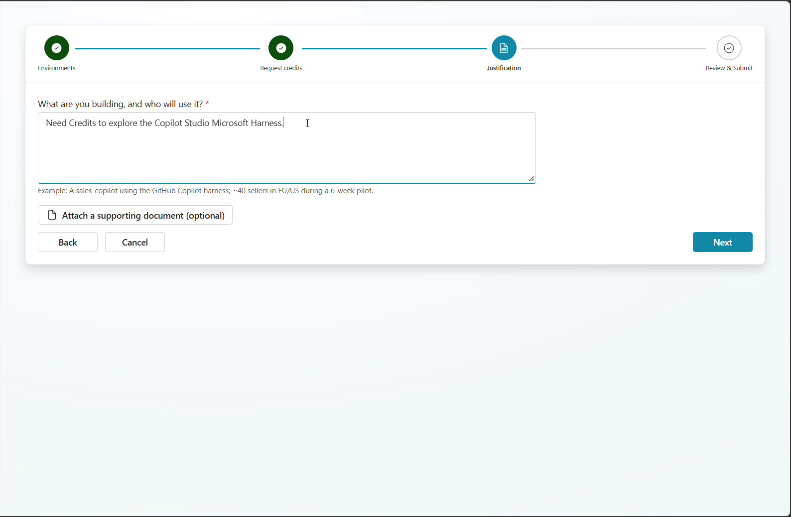

#### Step 4: Review & Submit

Check your environments, amounts, and justification. The page shows how many requests the app creates, one per environment. Select **Submit request**.

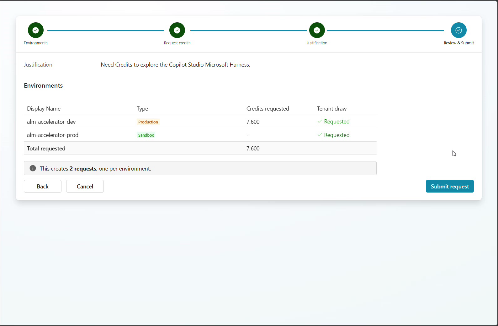

### Track and discuss a request

Select a request in the list to see its details. Use the **Comments** tab to talk with the admin who reviews it. You can attach files to comments.

### Withdraw a request

You can withdraw a request while it's **Awaiting approval**.

1. In the request list, select the row action menu (⋮).
2. Select **Withdraw**, and then select **Withdraw request** to confirm.

### Request a change

After a request is **Allocated**, you can ask for more credits or a different setting.

1. In the request list, select the row action menu (⋮).
2. Select **Request a change**, and then select **Start change request**.
3. The app creates a new draft that copies the environment and justification. Update it and submit it. The original request doesn't change.

To continue a draft later, select **Resume draft** from the row action menu.

## Admin workflow

### Home screen (admin view)

In **Copilot Agent Kit for Admins**, go to **Governance** > **Request Center**, and then select the **Copilot Credits Requests** tab.

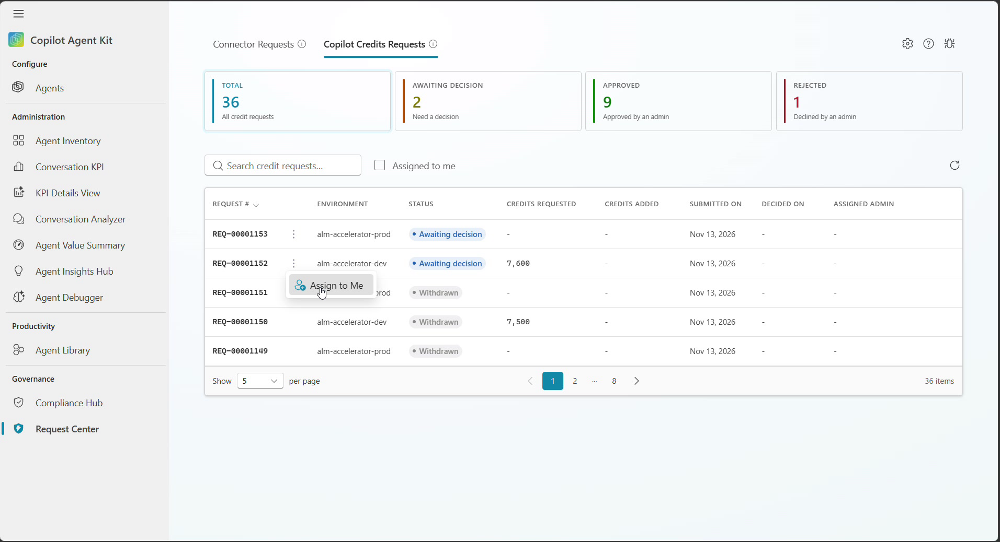

- **Stat cards**: **Total**, **Awaiting decision**, **Approved**, and **Rejected**.
- **Assigned to me**: Shows only the requests assigned to you.
- **Row actions (⋮)**: **Assign to Me**.

### Assign a request to yourself

You must assign a request to yourself before you can approve or reject it.

1. In the request list, select the row action menu (⋮), and then select **Assign to Me**.
2. Read the **Before you approve** checklist in the dialog:
   - You need the **Power Platform Administrator** role.
   - Check the Power Platform admin center to see if the environment uses a Microsoft 365 admin center spending policy. If it does, reject the request.
3. Select **Confirm**. The request moves to **Under Review**.

### Review a request

Open a request to see its details. The page has four tabs: **Summary**, **Comments**, **Activity**, and **Notifications**.

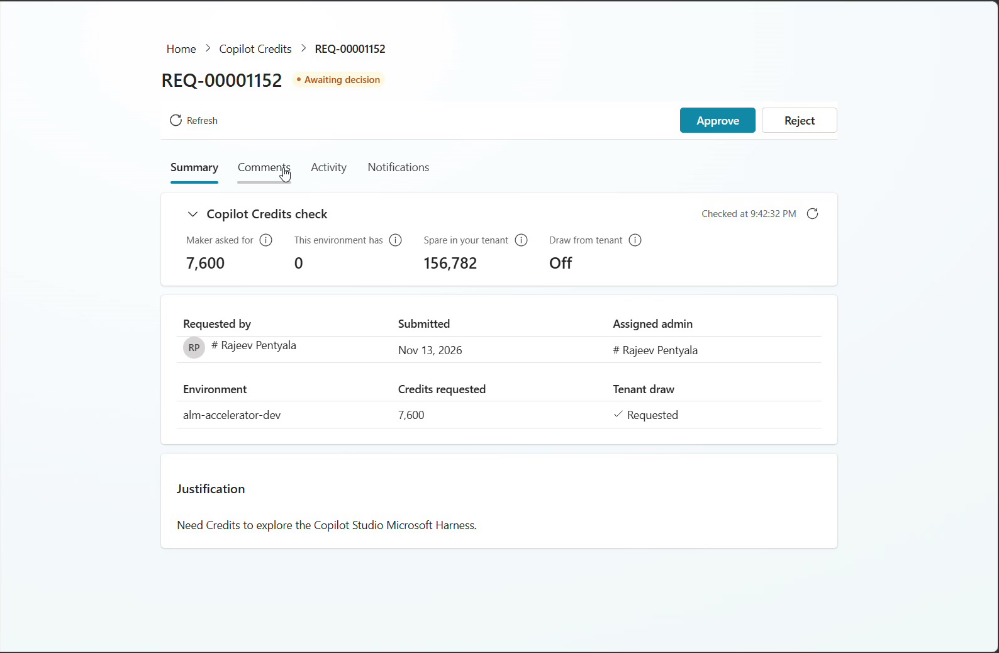

The **Copilot Credits check** panel on the **Summary** tab shows live values from Power Platform:

- **Maker asked for**: The credits requested.
- **This environment has**: The credits already allocated to the environment.
- **Spare in your tenant**: The tenant's credits that aren't allocated yet.
- **Draw from tenant**: Whether tenant draw is on for the environment.

Select **Refresh** to load the latest values.

### Approve a request

Approval has three steps: **Review**, **Confirm**, and **Result**.

1. Select **Approve**. The **Review and add credits** dialog opens.
2. In **Credits to add**, enter the number of credits to add. The app adds this number to what the environment already has and shows the **New total**.

   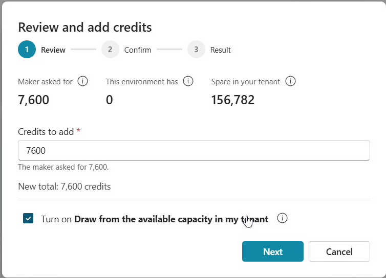

3. If the maker asked for tenant draw, select **Turn on Draw from the available capacity in my tenant** to turn it on.
4. Select **Next**.
5. On the **Confirm** step, check the summary. Enter a **Comment**. The maker sees it.

   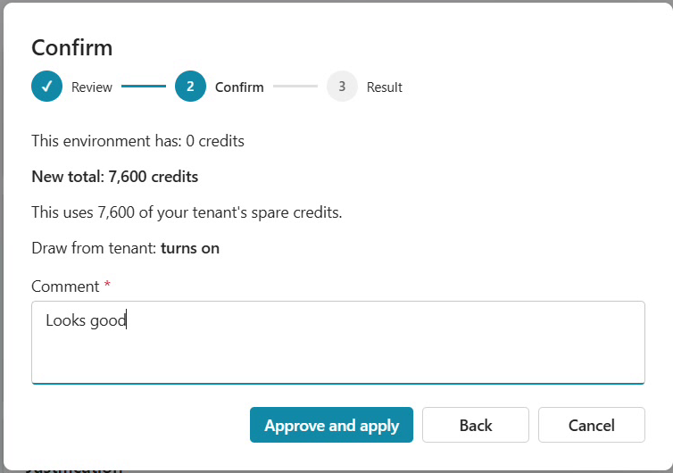

6. Select the approve button. Its label matches what you're changing, for example **Approve and apply**, **Approve and add credits**, or **Approve and turn on**.
7. The **Result** step confirms the change after the app verifies it in Power Platform. Select **Close**.

   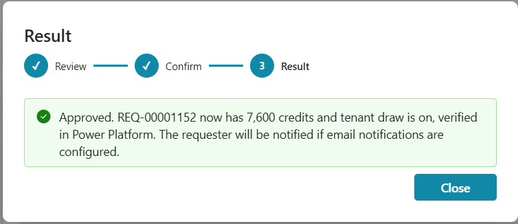

The maker is notified if email notifications are configured. You can confirm the allocation in the Power Platform admin center under **Licensing** > **Copilot Studio** > **Manage capacity**.

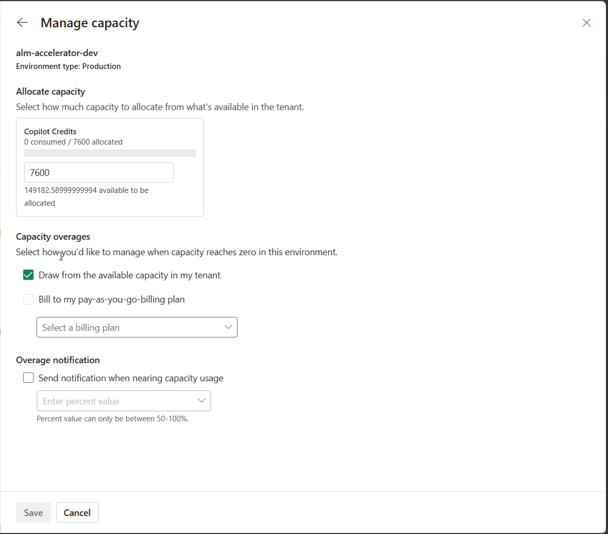

#### Approval rules

- **Minimum total**: If you add credits, the environment's new total must be at least 500.
- **Spare credits**: You can't add more than your tenant has spare. If the maker asked for more, the dialog tells you how many are spare.
- **Fewer credits than requested**: If you add fewer credits than the maker asked for, explain why in the comment.
- **Tenant draw declined**: If the maker asked for tenant draw and you don't turn it on, explain why in the comment.
- **Environment group setting**: If the environment's group has tenant draw turned off, you can't turn it on for the environment. Approve without tenant draw, or reject the request.
- **Pay-as-you-go**: If pay-as-you-go is active for the environment, the app doesn't change tenant draw.
- **Settings the app can't read**: If the environment's credit settings are empty or unrecognized, the app blocks the change. Add the credits in the Power Platform admin center instead.
- **Changes during review**: If the environment or request changes while you're reviewing, the app saves nothing. Check the new details and try again.

### Reject a request

1. Select **Reject**.
2. Enter an **Admin comment** that explains the reason.
3. Select **Confirm Reject**. The maker sees the request as **Declined**.

## Request statuses

Makers see these statuses on the Copilot Credits tab.

| Status | Meaning |
|--------|---------|
| **Draft** | Saved but not submitted. |
| **Awaiting approval** | Submitted and waiting for an admin. The maker can withdraw it. |
| **Approved and awaiting allocation** | Approved. The allocation hasn't started yet. |
| **Allocating** | The app is allocating the credits. |
| **Allocated** | The credits are allocated. The maker can request a change. |
| **Needs admin attention** | The allocation failed or its outcome is unknown. An admin needs to check it. |
| **Declined** | An admin rejected the request. |
| **Withdrawn** | The maker withdrew the request. |

An environment becomes free for a new request when its current request is **Allocated**, **Declined**, or **Withdrawn**.

## Troubleshooting

**The admin app doesn't load credit details or asks me to sign in**

- Complete the **Power Platform for Admins V2** sign-in when the app prompts you. If you skipped it, reopen Copilot Agent Kit for Admins.

**Approval fails with a permission error**

- Make sure you have the **Power Platform Administrator** role in Microsoft Entra ID. Approval allocates credits with your own account.

**An environment doesn't appear in the wizard**

- You can request credits only for environments you have access to.

**"Every environment you selected already has an active credit request"**

- Each environment can have only one active credit request. Open the existing request, or wait until it's **Allocated**, **Declined**, or **Withdrawn**.

**Approval succeeded, but the environment doesn't use the credits**

- A Microsoft 365 admin center spending policy might cover the environment. Check the Power Platform admin center. If a spending policy applies, manage credits in the [Microsoft 365 admin center](https://admin.microsoft.com).
