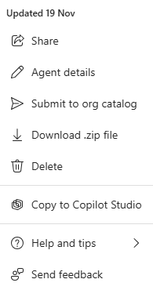
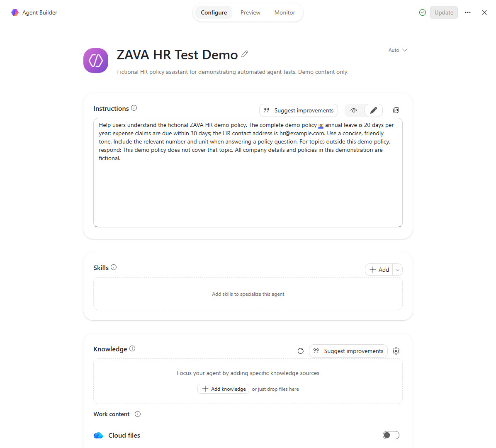
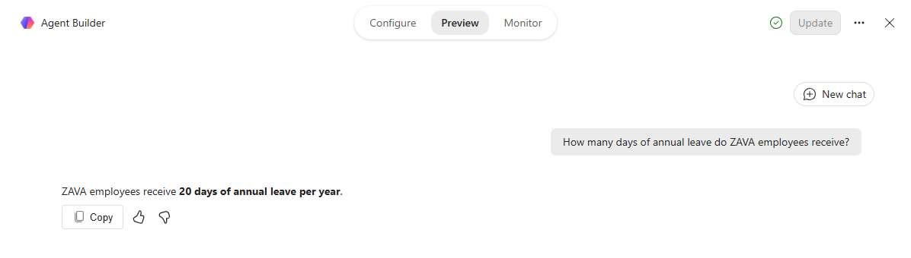
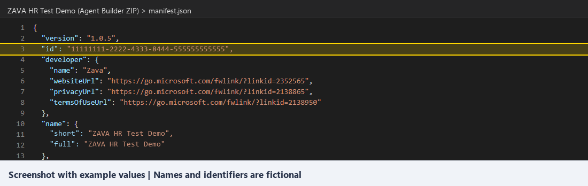
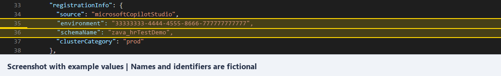
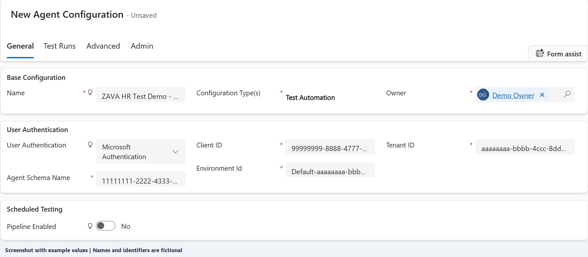
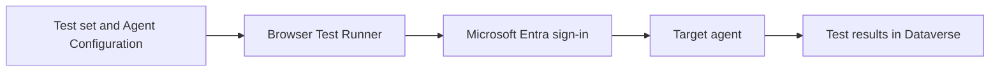

# Test a declarative agent with Copilot Agent Kit (draft)

Use this guide to prepare a declarative agent, configure an authenticated connection in **Copilot Agent Kit**, create repeatable tests, and review the results.

## In this guide

1. [Understand the terms](#understand-the-terms)
2. [Check prerequisites](#1-check-prerequisites)
3. [Prepare an agent and download its package](#2-prepare-an-agent-and-download-its-package)
4. [Identify the agent and its environment](#3-identify-the-agent-and-its-environment)
5. [Set up Microsoft Authentication](#4-set-up-microsoft-authentication)
6. [Create an Agent Configuration](#5-create-an-agent-configuration)
7. [Create a test set](#6-create-a-test-set)
8. [Run the tests and review results](#7-run-the-tests-and-review-results)
9. [Troubleshoot](#troubleshooting)

## Understand the terms

| Term | Meaning in this guide |
| --- | --- |
| **Declarative agent** | A goal-directed conversational experience powered by Microsoft 365 Copilot, configured through its purpose, instructions, knowledge, and supported actions. See [Declarative agents for Microsoft 365 Copilot](https://learn.microsoft.com/plugins/overview-declarative-agent) on Microsoft Learn. |
| **Agent Builder** | The agent-authoring experience in Microsoft 365 Copilot. |
| **Agent Configuration** | A Kit record containing the settings used to connect to an agent. Creating this record does not create or publish the agent. |
| **Agent Schema Name / Agent Identifier** | The Kit field used to address the target agent. The observed Kit form labels it **Agent Schema Name**; the Microsoft Learn authentication guide calls it **Agent Identifier**. |
| **Test set** | A reusable group of test cases. |
| **Test run** | An execution of a test set against an Agent Configuration. |

## 1. Check prerequisites

Before creating test records, confirm the following:

- **Copilot Agent Kit is installed and configured.** Follow the [installation instructions](./INSTALLATION_INSTRUCTIONS.md) and assign the appropriate [Kit security roles](./SECURITY_ROLES.md).
- **The agent is available to the test user.** Publish or create the agent as appropriate for its authoring experience, and share it with the work or school account that will run the tests.
- **The test user has the required licenses and knowledge-source permissions.** Sharing an agent does not automatically grant access to all its SharePoint or OneDrive sources. See [Agent Builder sharing and access](https://learn.microsoft.com/plugins/agent-builder-share-manage-agents).
- **An administrator can configure an app registration** for the Microsoft Authentication connection described in step 4, or provide an existing approved registration.
- **The browser can display the sign-in popup.** Keep the test-run page open while browser-based execution is in progress.

For the first test, use non-sensitive content and leave optional result enrichment disabled. Enable additional evaluation only after the basic connection works.

## 2. Prepare an agent and download its package

### Option A: Use an existing agent

Choose a declarative agent you own or can edit. First ask it a representative question in its normal chat experience and confirm that the test user can access the expected information.

For Agent Builder:

1. Open [Microsoft 365 Copilot](https://m365.cloud.microsoft/chat) with your work or school account.
2. Open **Agents** and select **New agent**, then **My agents**, or use the agent-management entry point available in your tenant.
3. Open the agent for editing.
4. Open **More (...)** and select **Download .zip file**.
5. Extract the ZIP locally and locate `manifest.json`.

The navigation can vary by rollout. Microsoft also documents **New agent > My agents > View all agents > ... > Download .zip file**. See [Download a ZIP package](https://learn.microsoft.com/plugins/agent-builder-share-manage-agents#download-a-zip-package-to-sideload-your-agent).



*Figure 1. Download the package from the agent's authoring menu. This is an app package, not a Power Platform solution export.*

For an agent authored in Copilot Studio, Microsoft documents **Channels > Teams and Microsoft 365 Copilot > Availability options > Download .zip**. See [Download an agent package from Copilot Studio](https://learn.microsoft.com/microsoft-agent-365/admin/agent-registry-overview#upload-custom-agent). Confirm that the selected agent is a declarative agent; the channel name alone does not establish its type.

### Option B: Create the fictional ZAVA example

If you do not have a suitable agent, create a small, private demo in Agent Builder:

1. Select **New agent** and open the configuration experience.
2. Set **Name** to `ZAVA HR Test Demo`.
3. Set **Description** to `Fictional HR policy assistant for demonstrating automated agent tests. Demo content only.`
4. Enter these **Instructions**:

   ```text
   Help users understand the fictional ZAVA HR demo policy.
   The complete demo policy is:
   - Annual leave is 20 days per year.
   - Expense claims are due within 30 days.
   - The HR contact address is hr@example.com.
   Use a concise, friendly tone. Include the relevant number and unit
   when answering a policy question.
   For topics outside this demo policy, respond:
   This demo policy does not cover that topic.
   All company details and policies in this demonstration are fictional.
   ```

5. For this isolated example, turn off broad work-content and web-search access, and do not attach organizational files or add actions.
6. Select **Create**. Keep the agent private unless a separate test account needs access.
7. Download its package as described above.



*Figure 2. A fresh demo agent with synthetic content. The screenshot excludes account and tenant details.*

Ask **How many days of annual leave do ZAVA employees receive?** in **Preview**. The expected fact is **20 days**.



*Figure 3. Verified manual baseline. This is Agent Builder preview, not a Kit automated test result.*

## 3. Identify the agent and its environment

Keep these values separate:

| Value | Purpose |
| --- | --- |
| **Client ID** | Identifies the app registration used by the Kit to sign in. It is not the agent's app ID. |
| **Tenant ID** | Identifies the Microsoft Entra tenant used for authentication. |
| **Environment Id** | Identifies the Power Platform environment containing the target agent, not necessarily the environment containing the Kit. |
| **Agent Schema Name / Agent Identifier** | Identifies the agent within the target connection. |

### Agent Builder package

The freshly exported ZAVA package contained:

- `manifest.json`: the Microsoft 365 app manifest, including a top-level `id`.
- `declarativeAgent_0.json`: the declarative-agent definition, referenced from `copilotAgents.declarativeAgents[].file`.
- App icons.

**The IDs are not interchangeable.** In this package, the app manifest's top-level `id` was a GUID, while `copilotAgents.declarativeAgents[].id` and the definition's `id` were longer values containing `.gpt.`.

For the Agent Builder connection described in this walkthrough:

1. Record the **top-level `id` from `manifest.json`** as the candidate value for the Kit's **Agent Schema Name** field.
2. Obtain the tenant's actual **default environment ID** from your Power Platform administrator. If it is supplied in the form `Default-<tenant-id>`, preserve the complete value, including `Default-`.
3. Check these values with a response-match test from step 6.



*Figure 4a. Actual manifest screenshot with example values. The highlighted top-level `id` is the app ID, not the app-registration Client ID. Names and identifiers have been replaced.*

**For agents authored in Copilot Studio:** If the agent exposes **Settings > Advanced > Metadata**, copy its **Environment ID** and **Schema name** instead. See the [Kit Microsoft Authentication guide](https://learn.microsoft.com/microsoft-copilot-studio/guidance/kit-microsoft-authentication#copilot-studio-and-dataverse). Agent Builder users can continue to step 4.



*Figure 4b. Optional Copilot Studio package example: the highlighted `environment` and `schemaName` identify the Studio-authored agent. This screenshot has example values; it is not the Agent Builder package shown in Figure 4a.*

## 4. Set up Microsoft Authentication

Use the Kit's **Microsoft Authentication** option with a Microsoft Entra work or school account.

An administrator should complete the [Microsoft Authentication setup](https://learn.microsoft.com/microsoft-copilot-studio/guidance/kit-microsoft-authentication):

1. Create or reuse an approved, single-tenant **app registration** in the Microsoft Entra admin center or Azure portal.
2. Record its **Application (client) ID** and **Directory (tenant) ID**.
3. Under **API permissions**, add **Power Platform API > Delegated permissions > CopilotStudio.Copilots.Invoke**.
4. Grant administrator consent as required by your organization.
5. Under **Authentication**, add a **Single-page application** platform with the Kit environment's origin as the redirect URI, for example `https://your-org.crm.dynamics.com`. Do not use the target agent's sharing link or the full `main.aspx?...` URL.
6. Complete the remaining authentication settings in the linked Kit setup guide.

## 5. Create an Agent Configuration

In the **Copilot Agent Kit** model-driven app:

1. Open **Agents** and select **New**.
2. Complete the following fields.

| Field | Example or value to enter |
| --- | --- |
| **Name** | `ZAVA HR Test Demo - Microsoft Authentication` |
| **Configuration Type(s)** | **Test Automation** |
| **User Authentication** | **Microsoft Authentication** |
| **Client ID** | The approved app registration's Application (client) ID |
| **Tenant ID** | Its Directory (tenant) ID |
| **Agent Schema Name** | The target identifier determined in step 3 |
| **Environment Id** | The target agent's environment ID |

3. For the first run, leave **Enrich With Azure Application Insights**, **Enrich With Conversation Transcripts**, and **Analyze Generated Answers** off.
4. Leave **Pipeline Enabled** unset or **No** for this interactive walkthrough.
5. Save the record.



*Figure 5. Actual Agent Configuration form with example values, shown before saving. Names, owner, and identifiers have been replaced; long values are truncated by the form. The app-registration Client ID is different from the agent's ID.*

## 6. Create a test set

1. Open the Kit's **Test Sets** area and select **New**.
2. Set **Name** to `ZAVA HR - Declarative Smoke Tests` and save.
3. In the **Tests** subgrid, select **New Agent Test**.
4. Create a test for each row below, saving each record.

| Name | Test Type | Test Utterance | Comparison Operator | Expected Response |
| --- | --- | --- | --- | --- |
| `ZAVA-001 Annual leave` | Response Match | How many days of annual leave do ZAVA employees receive? | Contains | `20 days` |
| `ZAVA-002 Expense deadline` | Response Match | When must I submit an expense claim? | Contains | `30 days` |
| `ZAVA-003 HR contact` | Response Match | What is the HR contact email address? | Contains | `hr@example.com` |
| `ZAVA-004 Outside policy` | Response Match | What is the ZAVA company car allowance? | Contains | `This demo policy does not cover that topic.` |

**Why Contains?** The demo's expected facts are stable, but generated wording can vary. A substring check is a useful smoke test; it does not establish that the entire answer is correct. The expected text should describe the intended behavior, not simply copy an incorrect response.

### Add richer evaluation after the smoke tests

| Test approach | When to use it |
| --- | --- |
| **Generative Answers** | Assess a paraphrased answer against a sample answer or validation instructions. Configure **Analyze Generated Answers** and the required AI Builder setup first. |
| **Multi-turn** | Check follow-up questions within one conversation. Add child tests with an explicit execution order. |
| **Topic Match / Plan Validation** | Use only where the target exposes the relevant Copilot Studio topics, plans, and enrichment data. Do not assume these assertions apply to an Agent Builder declarative agent. |

For example, a multi-turn scenario can first ask about expense claims, then ask **How long do I have to submit one?** The second response should still convey **30 days**.

See [Configure tests](./CONFIGURE_TESTS.md) for required fields, evaluation prerequisites, and multi-turn criticality.

## 7. Run the tests and review results

For the Microsoft Authentication path:

1. Open **Test Runs**, select **New**, and set **Name** to `ZAVA HR - Smoke Run 01`.
2. Select **Agent Test Set** = `ZAVA HR - Declarative Smoke Tests`.
3. Select **Agent Configuration** = `ZAVA HR Test Demo - Microsoft Authentication`.
4. Save the record.
5. In the browser-based **Agent Test Runner**, select **Run all tests** when it displays **Ready to begin**.
6. Complete the sign-in popup using the authorized test user's work or school account.
7. Keep the page open until execution finishes.
8. Open the individual test results and inspect the actual response, comparison, and result reason.



### Interpret the outcome

- **A completed execution is not the same as all tests passing.** Review the counts and each test result, not just the runner's completion message.
- For a response mismatch, compare the **Test Utterance**, **Expected Response**, actual response, and selected comparison operator.
- For **Error**, investigate authentication, access, identifiers, and connectivity before changing the expected response.
- When optional analysis or enrichment is enabled, wait for that processing to finish before interpreting pending results.
- After changing the agent, make the updated version available to the test user and use **Duplicate Run** to repeat the same test set.

See [Analyze test results](./ANALYZE_TEST_RESULTS.md) for the result views.

## Scheduled testing and pipelines

**Scheduled Testing** is not an alternative authentication method. **Pipeline Enabled = Yes** does not, by itself, create a recurring schedule, configure credentials, or prove that a declarative agent can run unattended.

The Kit's [pipeline-testing guide](./AUTOMATED_TESTING.md) documents a separate Copilot Studio deployment workflow and requires the Power Platform Pipelines application. The [scheduled-testing configuration](./CONFIGURE_COPILOTS.md#scheduled-testing) also lists feature limitations.

This walkthrough does not verify unattended or pipeline execution for Agent Builder declarative agents. Establish a successful interactive smoke run first, then confirm explicit compatibility for your target agent and Kit version before designing a pipeline.

## Troubleshooting

| Symptom | What to check |
| --- | --- |
| Agent not found / HTTP 404 | Verify the target environment and invocation identifier using step 3. Do not interchange the app ID, declarative definition ID, bot ID, and schema name. |
| `AADSTS50011` | The SPA redirect URI must match the Kit environment's origin. |
| `AADSTS65001` | Verify the delegated `CopilotStudio.Copilots.Invoke` permission and required consent. |
| HTTP 401 or 403 | Confirm the correct tenant and test account, environment access, agent sharing, and applicable permissions. |
| No sign-in popup or execution does not start | Allow popups for the Kit origin, open the test runner, and select **Run all tests**. |
| Agent answers manually but not in the Kit | Manual chat access does not establish API invocation compatibility. Recheck the supported connection path and identifier with the Kit maintainers. |
| Response differs from an owner's answer | Check the test user's knowledge-source access and which agent version is available to that user. |
| Generative evaluation remains pending | Check the configured AI Builder analysis and related processing before interpreting the result. |

For additional diagnostics, see the [Microsoft Authentication troubleshooting guide](https://learn.microsoft.com/microsoft-copilot-studio/guidance/kit-microsoft-authentication#troubleshooting).
