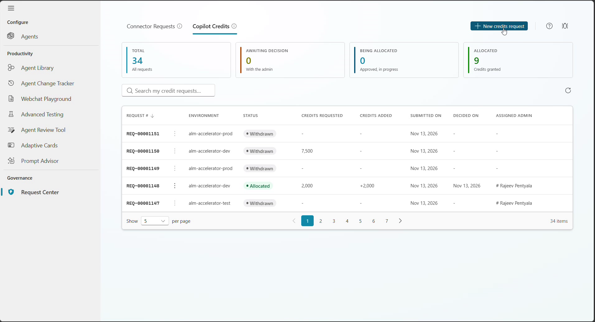

# Request Center overview

Request Center is where makers ask for Power Platform resources and admins approve them. It brings two request types together in one place, so makers have a single place to ask and admins have a single queue to review.

Request Center has two tabs:

| Tab | What makers request | What approval does |
|-----|---------------------|--------------------|
| **Connector Requests** | Access to connectors and connector actions for a group of environments | Creates or updates a data policy (DLP policy) in the Power Platform admin center |
| **Copilot Credits** | Copilot Credits for an environment, permission to draw from the tenant's unassigned credits, or both | Allocates the credits to the environment in the Power Platform admin center |

> [!NOTE]
> The **Connector Requests** tab was previously called **Power Shield**. It works the same way as before, and your existing requests are on this tab.

## In this article

- [Open Request Center](#open-request-center)
- [Roles](#roles)
- [What each tab needs](#what-each-tab-needs)
- [Next steps](#next-steps)

## Open Request Center

Request Center is available in both code apps. The apps show the experience that matches your role.

| App | Audience | Internal name |
|-----|----------|---------------|
| Copilot Agent Kit for Makers | Makers | `cat_copilotstudiokitformakers` |
| Copilot Agent Kit for Admins | Admins | `cat_copilotstudiokitforadmins` |
| Copilot Agent Kit (model-driven app) | All users. Routes you to the right code app based on your security role. | `cat_CopilotStudioAccelerator` |

To open Request Center from a code app:

1. Open **Copilot Agent Kit for Makers** or **Copilot Agent Kit for Admins**.
2. In the left pane, under **Governance**, select **Request Center**.
3. Select the **Connector Requests** tab or the **Copilot Credits** tab. In the admin app, the second tab is named **Copilot Credits Requests**.

To open Request Center from the model-driven app, open **Copilot Agent Kit**, expand **Governance** in the left pane, and select **Request Center**. If you have both the maker and admin roles, the admin app opens.

## Roles

Both tabs use the same Dataverse security roles.

| Role | What you can do |
|------|-----------------|
| **CAK - Maker** | Submit and track your own requests in Copilot Agent Kit for Makers |
| **CAK - Administrator** | Review, approve, and reject requests from everyone in Copilot Agent Kit for Admins |
| **System Administrator** | Use both apps |

Admins who approve requests also need the **Power Platform Administrator** role in Microsoft Entra ID. The approval runs with the admin's own account, so it fails without this role.

## What each tab needs

Each tab has its own setup. Set up only the tab you plan to use.

| | Connector Requests | Copilot Credits |
|---|---|---|
| **Makers app connections** | Power Apps for Makers, Microsoft Dataverse | Same as Connector Requests |
| **Admin app connections** | Four connection references, two of them HTTP with Microsoft Entra ID (preauthorized) | Power Platform for Admins V2. Each admin creates their own connection the first time they open the admin app. |
| **Cloud flows** | **PowerShield \| Sync Connectors** and **PowerShield \| DLP Request - Patch Custom Connector and Actions** | None |
| **Setup guide** | [Connector requests prerequisites](./POWER_SHIELD.md#prerequisites) | [Copilot Credits requests: before you start](./COPILOT_CREDITS_REQUESTS.md#before-you-start) |

> [!IMPORTANT]
> The **Connector Requests** tab doesn't work until **PowerShield | Sync Connectors** has run at least once. The **Copilot Credits** tab doesn't depend on this flow.

## Next steps

- [Govern connector access with connector requests](./POWER_SHIELD.md)
- [Request and approve Copilot Credits](./COPILOT_CREDITS_REQUESTS.md)
