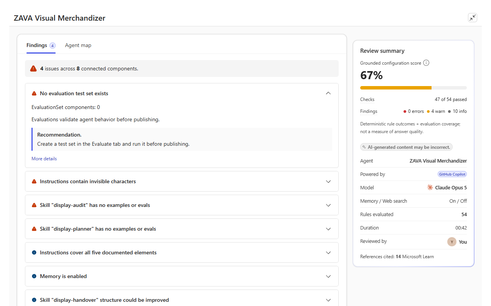
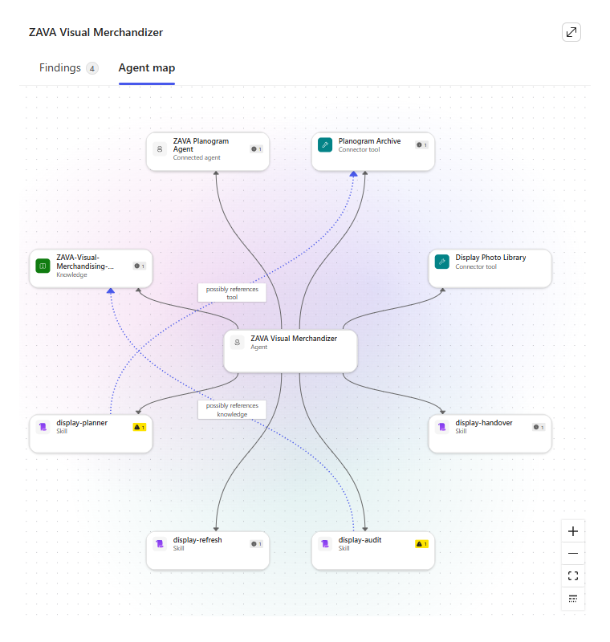
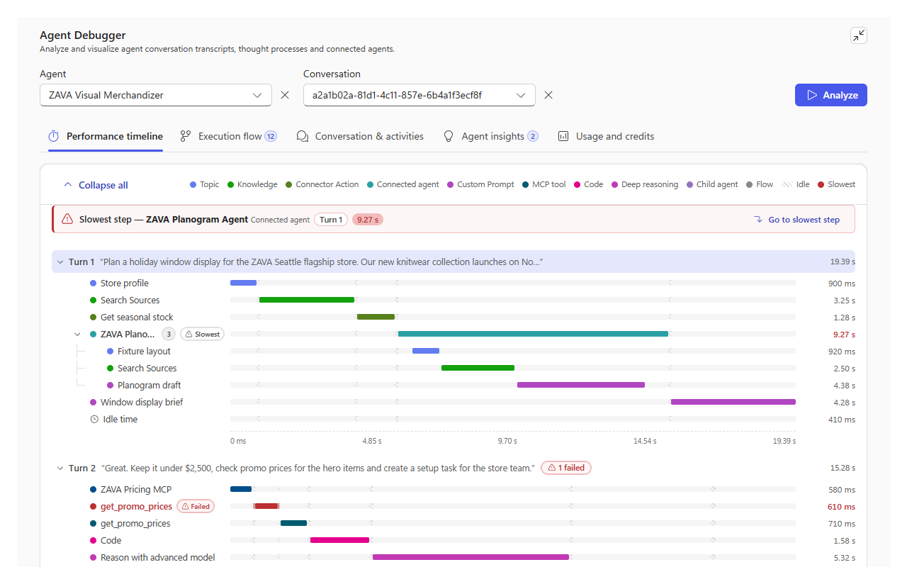
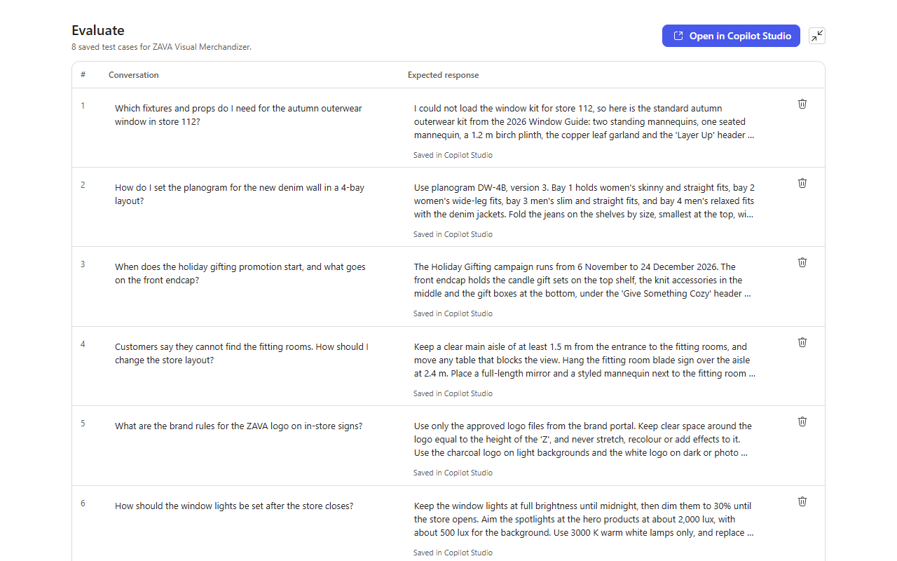

# Agent Review MCP App

An MCP app for Copilot Studio agents. It adds 3 views to a Copilot Studio agent or to Microsoft 365 Copilot:

- **Agent Review**: review the configuration of an agent, and see the findings on a map of its components.
- **Agent Debugger**: see how an agent handled a saved conversation, step by step.
- **Eval Builder**: make evaluation test cases from saved conversations, and save them as a Copilot Studio test set.

The app uses the permissions of the signed-in user. It does not run evaluations.

> This folder is part of the [Copilot Agent Kit](../../README.md) repository. Run all commands from `mcp-apps/copilot-agent-kit/`.

## Scenarios

Ask the agent in plain language. If you do not name an environment, the app uses the environment named `Copilot Studio Kit - Dev`.

### Review an agent

**Prompt:** `Review agent <agent name>`

The app starts a review job in the Kit, and the view shows the progress. Then the view shows the score, the findings and a map of the components of the agent. A map node with findings shows a count badge. Select the node to see its findings. A review can consume Copilot Credits.





Related prompts:

- `Browse existing Agent Review results` shows the saved reviews.
- `Show me a map of agent <agent name>` shows the component map without a review.

### Debug a conversation

**Prompt:** `Debug agent <agent name>`

The view opens the most recent saved conversation of the agent. To open a different conversation, add its conversation ID to the prompt. The tabs are **Performance timeline**, **Execution flow**, **Conversation & activities**, **Agent insights** and **Usage and credits**. **Conversation JSON** shows the complete saved transcript.



### Build evaluation test cases

**Prompt:** `Open Eval Builder for agent <agent name>`

The view reads up to 20 recent saved conversations of the agent (from the last 90 days) and makes up to 10 test cases. The expected responses come from the recorded answers. Review them before you use them. The view saves the cases as one Copilot Studio test set. You can edit or delete a case in the list. To run the evaluation, select **Open in Copilot Studio**.

If the agent already has a generated test set, the view shows that set and does not make a new one.



## How it works

```text
Copilot Studio agent --(OAuth 2.0, user sign-in)--> MCP server /mcp --(on-behalf-of)--> Dataverse
```

- The MCP server is a Node.js (Express) app on Azure App Service. It has 23 tools and 5 UI resources. Each UI resource is a single-file React app with Fluent UI. The host must support MCP Apps.
- The 5 UI resources are the 3 views and 2 more entry points, Agent Map and Review Browser, that use parts of the Agent Review view.
- Reviews use the Kit review job tables and the **Review Agent Components** workflow in `Copilot Studio Kit - Dev`. The app saves the review results in the environment that `AGENT_KIT_HOME_ENVIRONMENT_ID` identifies.
- The server has no database. It reads and writes Dataverse with the permissions of the signed-in user, and it keeps only temporary data in memory.

| View | Tools that open the view | Tools that the view or the agent uses |
| --- | --- | --- |
| Agent Review | `open_agent_review`, `show_agent_map`, `browse_agent_reviews` | `list_reviewable_agents`, `get_agent_map`, `get_connected_agent_map`, `start_agent_review`, `get_agent_review_status`, `finalize_agent_review`, `get_agent_review_result`, `list_agent_reviews` |
| Agent Debugger | `open_agent_debugger` | `list_debugger_agents`, `list_debugger_conversations`, `analyze_debugger_conversation`, `get_debugger_turn_details`, `get_debugger_child_transcript`, `get_debugger_conversation_transcript` |
| Eval Builder | `open_evaluation_builder` | `create_agent_evaluation_set`, `get_agent_evaluation_save`, `update_agent_evaluation_case` |
| All views | - | `get_initial_widget_data` |

## Prerequisites

- The Copilot Agent Kit ([installation instructions](../../INSTALLATION_INSTRUCTIONS.md)), with Agent Review set up, in an environment named `Copilot Studio Kit - Dev`
- An Azure subscription, and permission to create app registrations in Microsoft Entra ID
- Maker access in Copilot Studio. For Microsoft 365 Copilot, a Microsoft 365 Copilot license.
- Node.js 20 or later

For the full list, see [SELF-HOSTING.md](SELF-HOSTING.md#1-prerequisites).

## Get started

1. Deploy the app to your Azure subscription. Follow [SELF-HOSTING.md](SELF-HOSTING.md).
2. Add the MCP server to a Copilot Studio agent ([step 9](SELF-HOSTING.md#9-connect-copilot-studio)).
3. Optional: use the app in Microsoft 365 Copilot ([step 11](SELF-HOSTING.md#11-optional-microsoft-365-copilot-agents-toolkit)).

After a deployment, `/health` returns `{"status":"ok"}`, `tools/list` returns 23 tools and `resources/list` returns 5 resources ([step 8](SELF-HOSTING.md#8-do-the-checks)).

## Run locally

1. Copy `.env.sample` to `.env`. Set the `ENTRA_*` values of the server app registration (app 1 in SELF-HOSTING.md) and `AGENT_KIT_HOME_ENVIRONMENT_ID`.
2. Install the packages, and start the server:

   ```bash
   npm install
   npm run dev
   ```

The MCP endpoint is `http://localhost:3001/mcp`, and the health endpoint is `http://localhost:3001/health`. To see the tools and resources, run `npm run inspector`.

## Build and test

```bash
npm ci
npm run build
npm test
```

| Command | What it does |
| --- | --- |
| `npm run build` | Type-checks the code, builds the 5 UI resources and compiles the server to `dist/` |
| `npm test` | Runs the 3 test suites: `test:node`, `test:review-core` and `test:review-ui` |
| `npm run typecheck` | Type-checks the code without a build |
| `npm run validate:agent` | Validates the declarative agent with Agents Toolkit |
| `npm start` | Starts the built server (`dist/server/main.js`) |

## Troubleshooting

For sign-in, deployment and review job errors, see [SELF-HOSTING.md](SELF-HOSTING.md#13-troubleshooting).

**Copilot Studio shows "Can't authenticate to this tool" (HTTP 401).** The connection sends an expired token. In Power Apps, select the environment, and go to **Connections**. Fix or delete the Agent Review MCP connection, and sign in again. Make sure that the connector has a **Refresh URL** and the `offline_access` scope. Then start a new test chat.

Each `/mcp` request writes one line to the App Service log. The line shows the method, the tool name or resource URI, the HTTP status, the content encoding and the duration. For example:

```text
[MCP] tools/call open_agent_review -> 401 identity 4ms
```

To find the 401 responses of the last 24 hours, run this query in Log Analytics:

```kusto
AppServiceConsoleLogs
| where TimeGenerated > ago(24h)
| where ResultDescription has "[MCP]" and ResultDescription has "-> 401"
| project TimeGenerated, ResultDescription
| order by TimeGenerated desc
```

## Contributing

See [CONTRIBUTING.md](../../CONTRIBUTING.md) for the Kit. Read [AGENTS.md](AGENTS.md) before you change the code in this folder. [CLAUDE.md](CLAUDE.md) has the same content.
