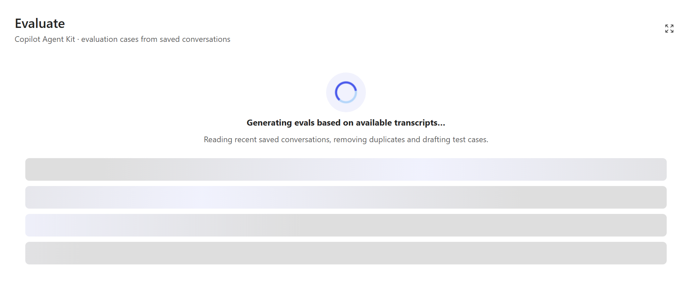
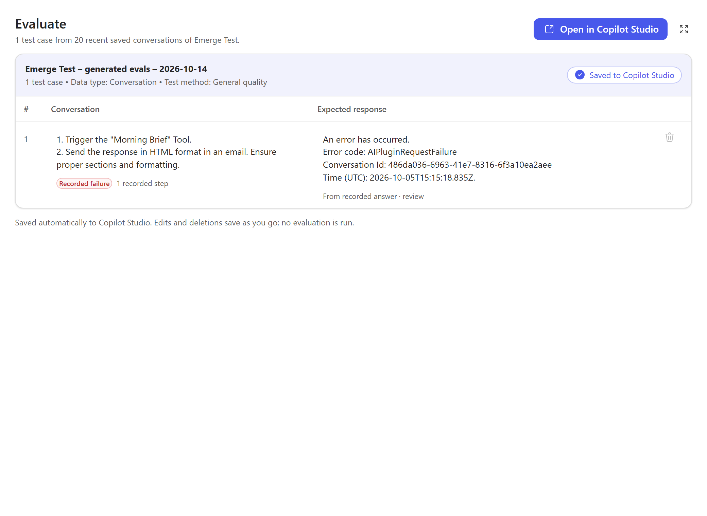
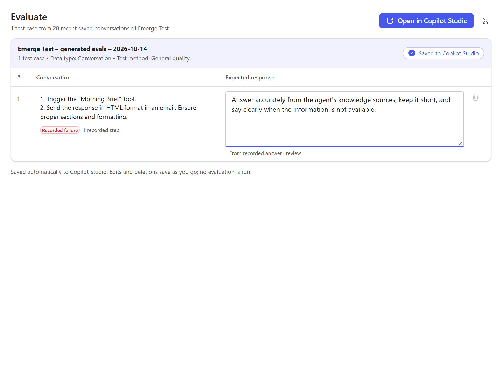
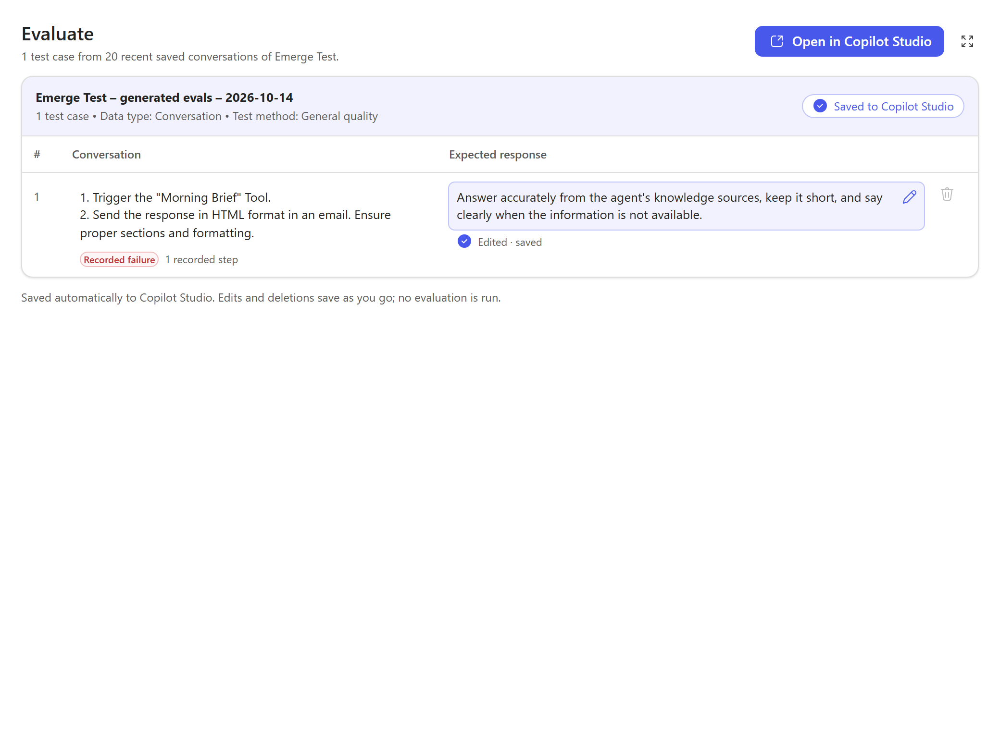
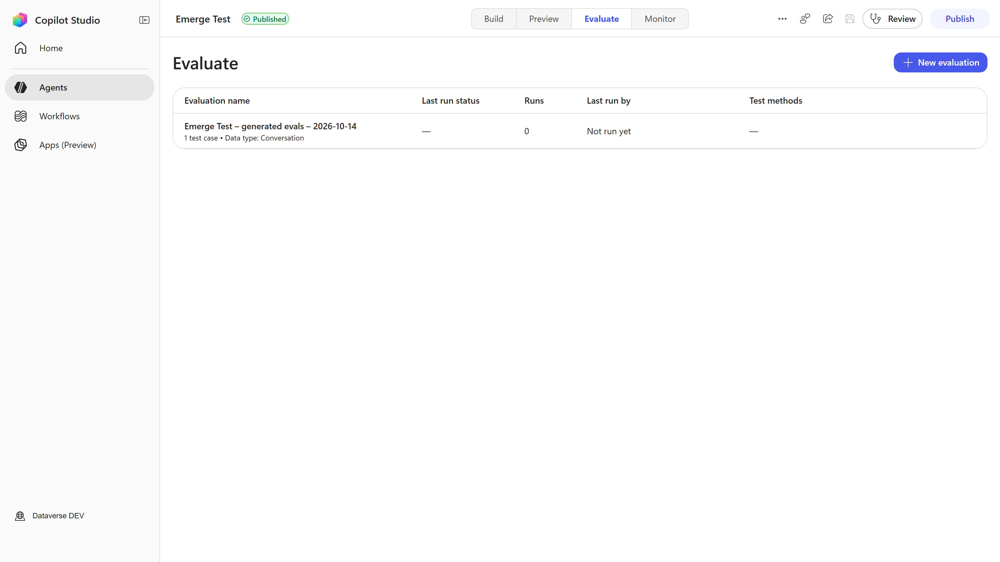
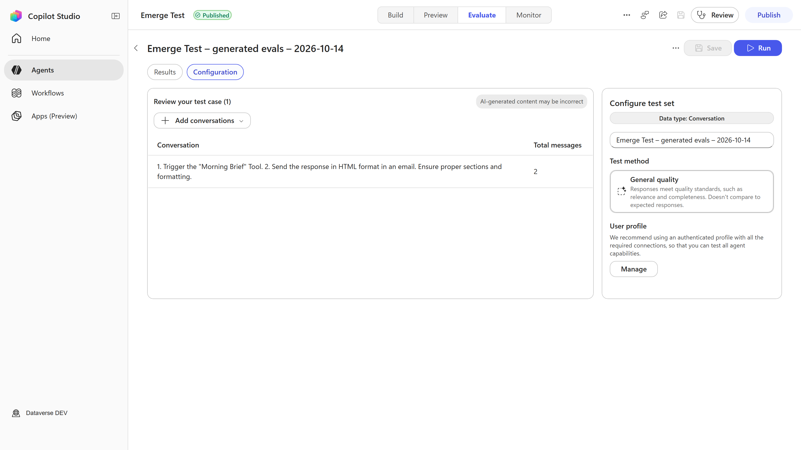

# Agent Review MCP App

`agent-review-mcpapp` is a standalone MCP app and Microsoft 365 declarative agent for Copilot Studio agents. One MCP server registers 27 tools and 5 UI resources. Agent Review, Agent Debugger, and Eval Builder are 3 standalone views. Agent Map and Review Browser are 2 entry points that reuse Agent Review UI parts. Each opener loads only its own complete view, without shared app tabs or embedded views. You can start an exact requested review, inspect saved maps and findings, debug saved conversations, and edit evaluation test cases that are generated from saved conversations. The app does not run evaluations.

> This folder is part of the [Copilot Agent Kit](../../README.md) repository. Run all the commands in this README from `mcp-apps/copilot-agent-kit/`.

## What this project includes

- An Express-hosted MCP server with 27 tools, at `http://localhost:3001/mcp` locally and at `https://<app-name>.azurewebsites.net/mcp` when you host it in Azure
- 5 interactive UI resources: 3 standalone views (Agent Review, Agent Debugger, and Eval Builder) and 2 entry points (Agent Map and Review Browser) that reuse Agent Review UI parts
- Application-local review logic and React UI components under `src/`
- Microsoft 365 Agents Toolkit config for local preview, provisioning, and publishing of the declarative agent
- Azure Developer CLI (`azd`) config and Bicep templates for the Azure App Service hosting

## Folder layout

| Path | Purpose |
| --- | --- |
| `src/agent-review/core/` | Agent Review domain model, parsing, rules, and scoring |
| `src/agent-review/server/` | Agent Review Dataverse access and server orchestration |
| `src/agent-review/ui/` | Agent Review view models and React components |
| `src/agent-map/` | Agent Map graph construction |
| `src/agent-debugger/` | Agent Debugger analysis, server logic, and UI components |
| `src/evaluation/` | Test-case generation from saved conversations, validation, caller-bound drafts, and native test-set save |
| `src/tools/` | MCP tool adapters |
| `src/widgets/` | MCP Apps entry points and shared widget integration |
| `appPackage/` | Declarative agent manifest, plugin definition, and app metadata |
| `env/` | Local environment templates and toolkit environment files |
| `infra/` | Bicep templates that `azd` uses to provision the Azure hosting |
| `scripts/self-host/` | Self-host scripts: `New-AgentReviewEntraApps.ps1` creates the 2 Entra apps, `build-runtime-package.sh` builds the Linux runtime package, and `tests/mock-run.ps1` tests the Entra script with mock commands |
| `azure.yaml` | `azd` project and service definition |
| `.webappignore` | Files that the App Service deployment package excludes |
| `SELF-HOSTING.md` | Guide to host the app in your own Azure subscription |

## Prerequisites

To run this project locally, you need:

- Node.js 22
- A Microsoft 365 development account
- A Microsoft 365 Copilot license
- Microsoft 365 Agents Toolkit for VS Code or the ATK CLI
- An Entra app registration with the required Dataverse and Copilot-related permissions
- A Power Platform environment with the target Copilot Studio agents

## Environment setup

Copy `.env.sample` to `.env` and fill in the required values:

```env
PORT=3001
MCP_SERVER_URL=
MCP_SERVER_DOMAIN=
ENTRA_CLIENT_ID=
ENTRA_CLIENT_SECRET=
ENTRA_TENANT_ID=
DATAVERSE_GLOBAL_DISCOVERY_URL=https://globaldisco.crm.dynamics.com
AGENT_KIT_HOME_ENVIRONMENT_ID=
```

This folder intentionally does not commit `.env`, `env/.env.local`, or other machine-specific environment files.

`AGENT_KIT_HOME_ENVIRONMENT_ID` selects the saved Review result store and history. It does not select the job backend or a named Review, Debugger, or Eval Builder target. A named prompt with no environment uses the exact name **Copilot Studio Kit - Dev**, resolved through the application's authenticated environment discovery. No tenant-wide environment ID is built into this rule. The manual Debugger form retains its configured environment fallback.

Review jobs use the existing `cat_agentreviewjob` and `cat_agentreviewjobitem` tables in **Copilot Studio Kit - Dev**, with the existing **Review Agent Components** processor. The server resolves exactly one environment with that name before job creation, file upload, queueing, reads, status, recovery, resume, and finalization input. An explicit agent/source environment remains unchanged, even when it is different from the job backend. Missing or ambiguous backend discovery and Dataverse errors are visible; the server does not switch to the source or home after a 404.

Finalization saves `cat_agentreviews` in the configured home. Saved inventory and reopen continue to use that same home and do not need Dev job metadata. If the home refuses the `cat_agentreviews` metadata read with HTTP 401 or 403 (for example, for a user who can use the review records but cannot read table metadata), the server uses the confirmed entity set name `cat_agentreviewses`. Other tables and other errors, such as a 404, stay visible. Existing saved results are not migrated. File content stays on the existing upload/download endpoints, not scalar row fields; the existing job file columns have a 32 MiB limit. This app correction does not create or change a publisher, solution, table, relationship, reference, processor, connection, or protected setting. Metadata and connection status do not prove caller write permission, processor execution, or MCP OBO access.

The MCP server reads the caller's bearer token from each request. It does not retain a previous caller assertion. A caller token with a known expired or future validity range receives HTTP 401 and a `WWW-Authenticate` header before any tool runs. Anonymous protocol and widget resource reads remain available. Decoded time claims can reject a token; they do not prove its identity or signature. Entra still validates the OBO exchange. A verified `invalid_grant` with AADSTS500133 reports `AUTH_REQUIRED`, with a sign-in instruction, instead of a generic `INTERNAL_ERROR`. That request also receives HTTP 401 and the authentication header; its tool error body keeps any requested saved ID. The app does not retry token exchanges or operations, bypass expiry, or use another credential. A new host token is separate from permission to start another Review or save. For client-side causes and log queries, see [Troubleshooting](#troubleshooting).

## Local development

Install dependencies:

```bash
npm install
```

Start the local development server and UI watcher:

```bash
npm run dev
```

Serve the app directly from TypeScript without the watch setup:

```bash
npm run serve
```

The health endpoint is available at `http://localhost:3001/health`, and the MCP endpoint is available at `http://localhost:3001/mcp`.

## Build and test

Install the locked dependencies, build the app, and run all tests:

```bash
npm ci
npm run build
npm test
```

`npm run build` type-checks the code, builds the widget UI with `build-ui.mjs`, and compiles the server with `tsconfig.server.json`. `npm start` runs the compiled server from `dist/server/main.js`.

`npm test` runs 3 suites in sequence. It stops at the first suite that fails.

| Script | Runner | Scope |
| --- | --- | --- |
| `test:node` | Node test runner (`tsx --test`) | Agent Debugger, Agent Map, Agent Review server, evaluation, MCP tool, widget logic (`src/widgets`), and `test/` tests, including the authentication configuration test |
| `test:review-core` | Vitest (Node) | Agent Review core tests |
| `test:review-ui` | Vitest (jsdom) | Agent Review UI, widget, and Agent Debugger component tests |

Run the TypeScript checks without a build:

```bash
npm run typecheck
```

Validate the declarative agent configuration with Agents Toolkit:

```bash
npm run validate:agent
```

Open the MCP Inspector against the local endpoint:

```bash
npm run inspector
```

### Known test failures

On 22 October 2026, `npm test` exits with code 1. The first suite, `test:node`, fails, so `npm test` does not run the other 2 suites. To see all results, run each suite separately:

```bash
npm run test:node
npm run test:review-core
npm run test:review-ui
```

| Suite | Result |
| --- | --- |
| `test:node` | 582 of 585 tests pass. 3 tests fail. |
| `test:review-core` | 11 of 11 tests pass. |
| `test:review-ui` | 302 of 302 tests pass. Vitest reports 7 unhandled errors and exits with code 1. |

These totals are from 22 October 2026, after `npm run build`. The Agent Map bundle test reads `dist/ui/agent-map.html`, and the test runner skips it when there is no build.

The 3 `test:node` failures are test expectations that do not agree with the current source:

1. `src/tools/conversationSelectionContract.test.ts`, "each Agent Review surface gets an isolated invocation identity": the test expects `state: "selecting", selectionId,`. In the source, `state` is `"error"` when the input has a `reviewId`, `"load-error"` when it has a `jobId`, and `"selecting"` in all other cases.
2. `src/tools/conversationSelectionContract.test.ts`, "agent instructions use direct exact requests and retain optional Create confirmation": the test expects the phrase "opener reply alone does not prove that the dialog or stepper is visible". `appPackage/instruction.txt` now says "An opener or result reply does not prove that the host displayed the Review UI."
3. `test/initial-widget-data-protocol.test.ts`, "SDK discovery retains the exact fields, required arguments and strict declarations of all 27 tools": `open_agent_debugger` has 2 input fields that the test does not expect, `startedAfter` and `startedBefore`.

The 7 unhandled errors come from the fullscreen tests in `src/widgets/agent-review/AgentReviewApp.test.tsx`. Each error is `TypeError: Cannot read properties of null (reading 'document')` in React `act`. In these tests, a `userEvent` click on an inline map node sends `mousedown`. Then d3-drag reads `event.view.document`, and jsdom gives a `null` view. A `fireEvent.click` on the node does not cause this error.

When you fix a failure, remove it from this section in the same commit.

## Azure hosting

The app runs on a Linux App Service. You deploy it with the Azure Developer CLI (`azd`). These files in this folder define the deployment:

- `azure.yaml` defines the `azd` project `agent-review-mcpapp` with one service, `web`. The service is the TypeScript project at the root of this folder, with `host: appservice`.
- `infra/main.bicep` runs at subscription scope. It creates the resource group and deploys `infra/modules/resources.bicep` into it. Its outputs include `WEB_URL`, `MCP_SERVER_URL` (the web app URL with `/mcp`), and `MCP_SERVER_DOMAIN`.
- `infra/main.parameters.json` maps these `azd` environment values to the template parameters: `AZURE_ENV_NAME`, `AZURE_LOCATION`, `AZURE_RESOURCE_GROUP_NAME`, `ENTRA_CLIENT_ID`, `ENTRA_TENANT_ID`, `ENTRA_CLIENT_SECRET`, and `AGENT_KIT_HOME_ENVIRONMENT_ID`.
- `infra/modules/resources.bicep` creates these resources:
  - A user-assigned managed identity
  - A Log Analytics workspace and Application Insights. A diagnostic setting sends all web app logs and metrics to Log Analytics.
  - A Key Vault with RBAC authorization. It holds the Entra client secret. The web app reads the secret through a Key Vault reference, with the managed identity and the Key Vault Secrets User role.
  - A Linux App Service plan (B1, Basic)
  - A Linux web app with the managed identity, on `NODE|20-lts`. It uses HTTPS only, TLS 1.2 or later, Always On, the health check path `/health`, and the startup command `npm start`. CORS permits only `https://m365.cloud.microsoft` and `https://*.m365.cloud.microsoft`.
  - App settings for Application Insights, the `ENTRA_*` values, and `AGENT_KIT_HOME_ENVIRONMENT_ID`. `SCM_DO_BUILD_DURING_DEPLOYMENT=false` and `ENABLE_ORYX_BUILD=false` stop a build on App Service during deployment.
- `.webappignore` excludes `.azure/`, `.git`, `.env*`, `env/`, `node_modules/`, and `.webappignore` from the deployment package.

Releases deploy a prebuilt Linux runtime package with `azd deploy web --from-package <zip>`. The package contains `dist/`, `node_modules/`, and `package.json`. App Service does not build during deployment, and `.webappignore` excludes `node_modules/`. Thus, a deployment from source does not include the runtime dependencies.

After a deployment, make sure that `https://<app-name>.azurewebsites.net/health` returns `{"status":"ok"}`. Then make sure that `tools/list` returns 27 tools and `resources/list` returns 5 resources on the `/mcp` endpoint.

The `.azure/` folder holds local `azd` environment state. Git ignores it. Do not commit it. Keep secret values in the `azd` environment and Key Vault, not in the repository.

A web app deployment does not publish the Microsoft 365 declarative agent package. The Agents Toolkit config (`m365agents.yml`) provisions and publishes that package in a separate step.

To host the app in your own Azure subscription, follow [SELF-HOSTING.md](SELF-HOSTING.md). The guide uses the scripts in `scripts/self-host/`.

## Connect from Copilot Studio

A Copilot Studio agent connects to the MCP server through a manual OAuth 2.0 connection. In this setup, the connection uses the same Entra app registration as the server (`ENTRA_CLIENT_ID`).

To add the MCP server to an agent, go to **Tools** > **Add a tool** > **New tool** > **Model Context Protocol**. Enter a **Server name** and a **Server description**. Then enter the values in this table:

| Field | Value |
| --- | --- |
| **Server URL** | `https://<app-name>.azurewebsites.net/mcp`. |
| **Authentication** | **OAuth 2.0**, type **Manual** |
| **Client ID** | `<ENTRA_CLIENT_ID>` |
| **Client secret** | A separate client secret of the same app registration. Do not reuse the server secret. |
| **Authorization URL** | `https://login.microsoftonline.com/<ENTRA_TENANT_ID>/oauth2/v2.0/authorize` |
| **Token URL template** | `https://login.microsoftonline.com/<ENTRA_TENANT_ID>/oauth2/v2.0/token` |
| **Refresh URL** | The same value as **Token URL template** |
| **Scopes** | `api://<ENTRA_CLIENT_ID>/access_as_user offline_access` |

`<ENTRA_TENANT_ID>` is the tenant of the app registration. It can be different from the tenant of the Azure subscription that hosts the App Service.

1. Select **Create**. Copilot Studio shows a callback URL.
2. Copy the callback URL.
3. In the Microsoft Entra admin center, open the app registration, and then open **Authentication**. Add the callback URL as a **Web** redirect URI. Keep all existing redirect URIs. Select **Save**.
4. In Copilot Studio, select **Next**. Select **Create a new connection**, and sign in.
5. Select **Add to agent**.
6. Start a new test chat.

Each connector gets its own callback URL, on `global.consent.azure-apim.net` or on `global-test.consent.azure-apim.net`. Add the exact URL of each connector. If the URL is missing, sign-in fails with AADSTS50011.

The app registration is single-tenant (`AzureADMyOrg`). Only accounts in its tenant can sign in. This includes guest accounts in that tenant.

Entra access tokens are valid for 60 to 90 minutes by default. The **Refresh URL** and the `offline_access` scope let the connection get a new token. Without them, calls fail with HTTP 401 after the token expires. To change the values of an existing connector, go to **Custom connectors** in Power Apps or Power Automate.

> [!CAUTION]
> The Agents Toolkit `provision` stage runs `aadApp/update` with `aad.manifest.json`. That manifest lists only the Teams redirect URI. If an Agents Toolkit environment uses the same app registration, a provision can remove the Copilot Studio callback URLs. Before and after a provision, read the redirect URIs:
>
> ```bash
> az ad app show --id <ENTRA_CLIENT_ID> --query web.redirectUris
> ```

## Key capabilities

The app has 5 UI resources: 3 standalone views and 2 entry points that reuse Agent Review UI parts.

- **Agent Review** (view): open or resume a review, search findings, filter by component or saved outcome, sort results, and inspect details in a responsive drawer
- **Agent Debugger** (view): search environments, agents, and saved conversations; inspect performance, execution flow, conversation activities, insights, and usage diagnostics
- **Eval Builder** (view): show the evaluation test cases that are generated from the agent's recent saved conversations, edit them inline, and keep them in one Copilot Studio test set
- **Agent Map** (entry point): render a deterministic component map for a selected agent
- **Review Browser** (entry point): browse previously persisted review results

Under the hood, the server registers 27 MCP tools:

| Group | Tools |
| --- | --- |
| Openers, one for each UI resource | `open_agent_review`, `open_agent_debugger`, `open_evaluation_builder`, `show_agent_map`, `browse_agent_reviews` |
| Agent Review and Agent Map | `list_reviewable_agents`, `get_agent_map`, `get_connected_agent_map`, `start_agent_review`, `get_agent_review_status`, `finalize_agent_review`, `get_agent_review_result`, `list_agent_reviews` |
| Agent Debugger | `list_debugger_agents`, `list_debugger_conversations`, `analyze_debugger_conversation`, `get_debugger_turn_details`, `get_debugger_child_transcript`, `get_debugger_conversation_transcript` |
| Eval Builder | `get_evaluation_draft`, `get_evaluation_native_support`, `create_agent_evaluation_set`, `get_agent_evaluation_save`, `update_agent_evaluation_case` |
| Widget data delivery | `get_initial_widget_data`, `get_app_view_resource`, `get_app_view_chunk` |

### Inline display

Inline views do not scroll vertically. Each view fits the host height budget: `containerDimensions.height`, else `maxHeight` minus the frame padding, else 600 px. A view does not force a minimum height above that budget. Content that does not fit shows a finite preview with a fullscreen action, for example **View all N findings in full screen**, or pages its rows when the host does not offer fullscreen. Fullscreen views and popups can scroll. Inline, only two areas scroll vertically: the 3-line question and expected-response boxes of Eval Builder, whose scrollbar shows only on hover or focus, and the content of the Agent Debugger **Performance timeline** tab, which shows the full timeline.

### Demo pacing

A static demo server can add the optional top-level `structuredContent.simulatedProgress` field to an `open_agent_review` or `open_evaluation_builder` result that is already final. The value is `true` (2-second steps) or `{ "stepMs": <number> }`, clamped to 250–10,000 ms. The view then plays its own waiting state with timers only. It makes no tool call and no save:

- Agent Review, for a completed review (`summary` or `fullReview` with a model), shows the real progress stepper and advances one stage per step, from **Parsing Configuration** to **Complete** (5 steps, 10 seconds at the default). It does not show **Continue in background** or **Cancel**. Then it shows the saved result as usual.
- Eval Builder, for generated cases, shows the "Generating evals based on available transcripts" loader for 3 steps (6 seconds at the default). Then it shows the cases as usual.

A whole playback stays within 16 seconds; more steps get shorter steps. A view plays it once for each result: not again after a display-mode change, and not in a new frame that receives the same result of the same tool call when session storage is available. This server does not send the field.

### Starting and resuming a review

Reviews can consume credits. A request such as "Review Zava Visual Merchandizer" calls `open_agent_review` with the exact `agentName`. `startReview: true` is an explicit intent hint, not a required flag: a clear name starts directly when the flag is omitted. The server checks only the supplied environment, or resolves exactly one **Copilot Studio Kit - Dev** when none is supplied. That same default is selected in the fallback form when no agent name is supplied. One exact, accessible agent starts one review and returns the acknowledged job ID for the stepper, without the selection form. Matching permits case and outer whitespace differences, but not partial names, compacted names, or cross-environment guesses.

Missing, unknown, duplicate, or unavailable targets keep the existing form without a start. Target, API, and sign-in errors remain visible. The form uses the selected record's current `componentIdUnique`, the existing `Agent Review <short date/time>` project-name rule, and optional transcript dates. The server keeps the internal 100-record transcript limit and rechecks the source version before it creates the job.

The form is optional for unresolved targets or manual selection. **Create** in that live form calls the app-only `start_agent_review` with `confirmed: true`. The direct request and confirmed action share one pending start for the same caller, target, and options. Conflicting options fail visibly instead of creating another job. A direct request keeps its result, including failures, for the same `requestId`; different request IDs share a pending target. Without a request ID, repeated direct calls reuse the same caller/target request. A new UUID is needed for an intentional later review. These guards are process-local, not durable across restarts, instances, or access-token changes; the tools do not claim protocol-level idempotence. Read-only `resumeOnly` recovery restores the original request or acknowledged `jobId`, never a replacement job.

`startReview: false` explicitly opens or prefills the manual form without starting a review. The authenticated selected target, including its exact component ID, makes Create available before the supplemental picker finishes loading. Review and Debugger selection lists omit per-agent image data. They retain every authorized list record, identity, version, ordering, search, and eligibility rule. Selected-agent map and analysis reads and Review history retain their icons. This does not infer a target from prompt text. A missing or stale selected record still shows an error. Manual target changes cancel obsolete startup data; an older environment response cannot replace a newer agent list.

Create shows the existing submission stepper immediately and permits only one pending start request. The request uses the registered tool inputs. Host and tool errors, including text-only MCP errors, are visible. Progress polling starts only after the server returns a job ID. Initial running data without an acknowledged ID shows an error instead of progress. You can continue in the background, resume progress, or reopen a job by its ID without starting another review. Tool text reports selection or the acknowledged job; it does not claim that a client has displayed the dialog or stepper.

Start errors include the failed stage and the Dataverse method, URL path, HTTP status, and service request ID when available. The diagnostics omit query strings, authorization headers, request bodies, and response bodies. A failed job-create response does not prove that no job exists. If job creation was acknowledged before an upload or queue error, the error keeps that job ID. **Check existing job** reads its status instead of creating another job; closing that error keeps the same job available for resume.

### Local Standard Review correction

The new local source candidate corrects the existing named and manual Review path for Standard agents with generative orchestration. It retains complete `AdaptiveDialog`, `TaskDialog`, and `AgentDialog` source, parsed documents, separate component content, original component identities, and exact action JSON pointers. These components use the `StandardTopic` evaluator contract and an independently implemented topic/action rubric. They are not renamed as skills or sent to the Skill evaluator. Existing Copilot skill inputs and older saved reviews remain supported.

Each Standard component has a SHA-256 that binds its complete redacted evaluator context. Finalization checks the retained source, action inventory, job attribution, and result identity before it saves findings. Partial, missing, malformed, or foreign results remain explicit; valid findings retain complete evidence, explanations, corrections, steps, and references. Saved Map and reopen use only the reviewed snapshot. Topic and action nodes stay outside the Skills view.

Lifecycle findings use the retained target harness and include Standard topics and executable actions in the composition record. The saved result overview uses that same target harness for its "Powered by" value. Neither view infers the target harness from the review worker. Older saved findings and the no-harness overview behavior are unchanged.

Malformed or unsupported Standard source fails before job creation, upload, or queueing. A component above the 50,000-token evaluator budget, more than 1,000 components, or a complete model above the saved-review budget also fails without truncation. Existing secret redaction and the 65,536-byte tool-result and 1,000,000-byte resource limits remain in place.

Standard component results require a processor with the Standard component route and matching output schema. The app uses the existing Dev processor; it does not import, replace, rebind, or activate the separate offline worker candidate. The target agent's Standard harness is separate from the review worker's execution harness. No new DeclarativeAgent manifest or standalone Skill upload entry point is added. Local snapshot and routing tests do not prove live processor support or paid execution.

### Agent Review findings

Completed and reopened results start on **Agent map**, built from the saved reviewed model and version. The compact header shows the agent name and expand/exit action. The result has exactly two tabs, in this order: **Findings** and **Agent map**. Findings keeps its error-and-warning count badge. Inline, the result shows only the header, the tab bar and the map. The inline map fills the height that the host gives, without a toolbar, View all findings action, unlinked-findings banner, or findings below it. Fullscreen retains Map/List, search, Filters and Reset. The radial layout, relationship evidence and direction, glow, grid and zoom controls are unchanged.

The Agent Map entry point and the Review map hide evaluation sets and test cases by default, in the initial filters and after Reset. The Filters switches, a deep link or a finding target can show them. Saved map filters include `defaultsVersion: 2`. A saved filter without that marker that equals a previous default opens with the new default; a filter with the marker keeps the saved categories.

The saved-snapshot notice is not shown above the map. The Review summary appears only in fullscreen, not in the inline map, the unavailable-map path, or the inline findings preview. An inline map has no side panel. A selected relationship shows its details in a compact overlay in the map box, with **Close details** and **Open full screen**. A restored selection does not open an overlay. Review history detail keeps its summary. These display changes do not change the saved model, version, date, findings, or map.

Each map node with linked saved findings shows a filled count badge in its header. The badge color and icon show the highest severity (error, warning, or information). Its tooltip and the node's accessible name give the count by severity, for example "2 findings: 1 error, 1 warning". The root agent node, nodes without linked findings, and nodes without saved attribution have no badge. Activate a badged node or the root agent with a mouse or keyboard, on the map or in the list, to select Findings and filter by that exact saved node. Inline activation requests fullscreen with the findings of that node. When the host does not offer fullscreen or refuses it, the inline Findings tab opens with that node filter. Map nodes have no inline details card. A node without linked findings or without attribution is only selected; in fullscreen, the inspector shows it. A node selected in fullscreen replaces the filter without another display request. It does not open a finding drawer. Component matching uses the normalized saved component ID; actions also require the exact action path. The root includes the complete saved Review. Missing attribution and zero matching findings are shown explicitly, without unrelated results. When the findings of the filtered node are only other check results, such as recorded configuration facts, fullscreen Findings shows them open. Clear the compact node-filter line to read all findings, including unmapped findings and check results without saved component IDs.

The next tab, node filter and map selection are saved before the host display request. They remain specific to the saved Review through a fullscreen remount. A return to inline, from the exit button or from the host, shows the clean map: the Agent map tab without a node filter, selection or overlay. Older Skills, Coverage and Checks tab snapshots open Findings. The expand/exit button remains visible in every host, including Studio. A failed or refused display request keeps the results usable and shows one neutral caption, not an error alert. No current-agent Map read or new Review job is needed. Duplicate rule IDs retain their original saved-array finding locators. An unavailable or conflicting saved Map does not hide the findings.

`get_agent_review_result` declares the same registered Review resource as `open_agent_review`. A model call with an existing `reviewId` can therefore open the saved Review UI without another job. Its plain `state`, `reviewId`, and `model` data stay available to existing widget consumers. `summary` and `fullReview` use that same saved model. A plain saved-result reply uses its review ID for local fullscreen state and cannot restore another review's active snapshot.

Inline, the Findings tab shows a finite preview of compact finding rows and **View all N findings in full screen**. When the host does not offer fullscreen, the preview pages its rows with **Previous page** and **Next page**. In fullscreen, Findings uses one grey summary strip with the same issue count as the tab badge and the saved map's non-agent component count, when available. Error, warning and information rows appear as severity-ordered accordion cards; the first card is open. Each card retains the saved fact, reason and accented recommendation. More details opens the existing drawer with all evidence, references, attribution and steps. Other check results remain behind one disclosure. The disclosure is open when the filtered node has only other check results. The drawer supports previous and next navigation, Escape to close, and focus return. Scores and saved check outcomes are unchanged: recorded configuration facts and checks that were not assessed are not counted as passes. The UI does not persist dismissals or reviewer overrides.

The existing end drawer keeps the Review Center's detail order. Error and warning verdicts display as **Fail** in the drawer; their saved severity and scoring remain distinct. Detail fields follow evidence, impact, recommendation, repair steps, references, and saved attribution. Only available saved fields appear. Full reference titles, URLs, action paths, and original step numbers remain visible. The drawer is an overlay on wide screens and fills a narrow screen. This layout does not consolidate duplicate findings, add Center mutation controls, or claim a pixel-exact match.

### Agent Debugger data boundaries

An explicit request such as "Debug Contoso Support" calls `open_agent_debugger` with the exact `agentName`. The server checks only the supplied environment, or **Copilot Studio Kit - Dev** when none is supplied. In fullscreen, a clear, valid target shows the **Agent**, **Conversation**, and **Analyze** controls in one row; the Environment selector is not shown. Case and outer whitespace differences are permitted; partial names, compacted names, duplicate names, and cross-environment guesses are not. Unresolved targets show the reason. Fullscreen shows the existing form.

Inline, the Debugger never shows the Environment, **Agent**, or **Conversation** pickers or **Analyze**, also when the host does not offer fullscreen or refuses it. The inline header does not show the selected agent and conversation. It shows a loading spinner only while data loads. The analysis of the selected conversation loads without a click. A Debugger without an analysis shows **Open full screen to choose an agent and a conversation** when the host offers fullscreen. Otherwise, it shows **Ask in chat for an agent and a conversation to debug.** The pickers and **Analyze** show only in fullscreen.

If the request supplies `conversationId`, the server checks that exact conversation in the selected target and date range before the app reads its saved analysis. An unknown or foreign conversation shows the selected agent's list with a visible reason, not another conversation. If no ID is supplied, the server selects the first authorized saved conversation in the existing most-recent-first list order. This temporary default does not run again after each list or filter reply. The user can select another conversation; reload preserves that selection. An empty list shows an empty state, and listing or analysis errors stay visible without choosing another target or conversation. Clearing the **Agent** selector returns to the manual form. Debugger reads saved data only: it never starts or finalizes a review and does not require a Review harness or component version. Classic and generative agents remain supported.

Agent search uses the existing server-side list of up to 500 active agents. Conversation ID search and session-start date filters run in Dataverse before the list limits. The selector shows up to 50 distinct conversations from 250 matching transcript records, not a complete inventory. `list_debugger_conversations.limit` accepts integers from 1 to 50; the existing service default and transcript-record bound are unchanged. The Debugger view does not show date filters or a conversation-ID box; the tool still accepts date bounds, and the opener's `conversationId` input still opens one exact conversation. Tabs stay on one line, and tabs that do not fit move to a **More tabs** menu.

Analysis retains the existing 500-record bound, compact initial transcript, and lazy turn and connected-agent detail loading. Execution-step and recommendation counts follow the selected session. Requests for details and JSON remain bound to the displayed analysis, even when a different conversation is selected for the next analysis.

The **Conversation & activities** tab shows the conversation and the activity list of the selected turn side by side; these parts never stack. The activity list is a vertical list, not a flow diagram; a connected agent is a group row with its own steps. From 1080 px, a third column shows the details of the selected activity, and the first activity is selected. From 640 px to 1079 px, for example inline with `inlineLayout: "full"`, a click opens the activity details in place below the row, and a second click closes them. Below 640 px, a **Conversation | Activities** switch shows one pane at a time. Each pane scrolls inside its own box. The activity list comes from the saved analysis, so it also shows when the lazy detail reads are not available. When a host refuses `get_debugger_turn_details` or `get_debugger_child_transcript` (for example with MCP error -32000 in the Copilot Studio test chat), or the read fails, the view keeps the analysis and the turn selection. It shows a short note at the activity details or at the connected agent, not a global error. Session start times show in the viewer's local time.

In fullscreen from 1080 px, the **Execution flow** tab shows three columns: the conversation, the flow diagram of all turns, and the details of the selected step. The steps are selectable, and the first step of the selected turn is selected. A click on a step of another turn, or on a user message, selects that turn and loads its details; a refused or failed read shows the same note in the details column. Each column scrolls inside its own box. Inline, also with `inlineLayout: "full"`, and in fullscreen below 1080 px, the tab shows only the flow diagram, and the steps are not selectable.

Inline, the **Performance timeline** tab shows the full timeline, the same as fullscreen: the legend, the slowest step, and all turns expanded with their step rows, with expand and collapse. When the timeline is taller than the host height budget, the tab content scrolls inside the view; the view itself does not scroll. The turn actions open the inline **Execution flow** or **Conversation** preview. The other tabs show finite previews with a fullscreen action. Fullscreen shows the complete tabs.

The optional top-level `structuredContent.inlineLayout` field of an `open_agent_debugger` result (`"full"` or `"preview"`) selects the inline tab layout. With `"full"`, inline shows the same complete tabs as fullscreen, for example the **Execution flow** diagram, and the tab content scrolls inside the view. A missing value or `"preview"` keeps the inline previews. The first valid value stays for the life of the view. This server does not send the field.

**Conversation JSON** loads saved parent-agent records on demand through the authenticated, app-only `get_debugger_conversation_transcript` MCP tool. It uses an exact agent/conversation lookup and rejects partial data or data above 500 records or 8 MiB. It includes all parent-agent sessions, independent of the selected session or JSON search. Connected-agent transcripts remain separate. Only the internal activity session key is removed. Turn-level JSON inspection remains available.

JSON search uses the complete text, with up to 10,000 matches and virtual rendering for large documents. Downloads use the MCP host's `downloadFile` capability. The UI reports unsupported or denied downloads; it does not bypass host permissions with a sandbox download. Copy is available when the host permits clipboard access.

**Usage diagnostics** show metrics from saved activities when available. Missing metrics remain unknown; an explicit reported zero remains zero. Copilot Credits and AI Builder credits stay separate. The view distinguishes reported values from diagnostic estimates for supported completed events, states their source and confidence, and does not count aggregate and step observations twice. Estimates use documented reference rates and exclude meters that cannot be identified in the saved data. They are not a billing statement or a forecast.

### Eval Builder

Open Eval Builder through `open_evaluation_builder` with an exact agent name. Its separate resource contains only Eval Builder. Agent Review and Debugger keep their own openers and resources. Each widget has one MCP SDK bridge, its own data and app-only metadata, and no shared app navigation. Opening Eval Builder does not start a Review or run an evaluation. The view saves its cases as described below.

An exact named request uses the authenticated **Copilot Studio Kit - Dev** environment only when no environment was supplied. An explicit environment stays unchanged. The agent name is required. A missing, unknown, or ambiguous agent or environment shows the reason in the view, and the view does not generate or save cases. The `mode` input is ignored; it is kept only so that older callers do not fail. There is no selection form, conversation picker, export, or chat suggestion action.

Each independent root keeps its view-specific React ID prefix, scoped styles, theme, and local dialog portals. A result bound to another view is ignored before initial-data recovery or chunk reads. Theme and display changes retain the current widget's data and metadata. Review results keep only their internal Findings and Agent map tabs.

#### Generated test cases

For an Eval Builder, eval, or test set request for a named agent, the agent calls `open_evaluation_builder` with the exact agent name. The view shows a "Generating evals based on available transcripts" animation, then a Copilot Studio **Evaluate**-style list with an **Open in Copilot Studio** button. There is no date range or conversation selection:

- When the agent already has a saved generated set, the view shows that set and does not generate or save. The server takes the newest active root set whose name starts with `<agent> – generated evals` and that has at least one active case (`src/evaluation/native.ts`). The subtitle reads "N saved test cases for <agent>.", and inline edits and deletions update that set. Existing sets are never deleted. When there is no such set, the server generates new cases as described below.

- The server reads up to 20 of the agent's most recent authorized saved conversations from the last 90 days (`src/evaluation/generate.ts`). Unreadable transcripts are skipped and counted; sign-in failures still fail the call.
- It keeps up to 10 single-pair cases. Recorded failures and longer recorded paths come first; duplicate questions and short follow-ups that need earlier context are dropped.
- Expected responses are pre-filled from the recorded answer and labeled "From recorded answer · review". They are evidence for review, not ground truth.
- The view saves exactly one Copilot Studio set for each generated draft. The save starts automatically as soon as the cases appear, through the same `create_agent_evaluation_set` path (General quality, atomic changeset, exact read-back), with the draft ID as its request ID. A remount or **Retry** does not create another set: the server shares the pending save of the same caller and draft or returns its receipt, and runs that same save again, with the same set and case IDs, only when no create was sent. When the save could not be confirmed, **Retry** only reads the saved set through `get_agent_evaluation_save`. There is no Save button and no set status row; save errors show in the banner. **Open in Copilot Studio** becomes available after a verified save.
- Each question and expected response is editable inline and saved when the field loses focus; cases can be deleted. Both use the app-only `update_agent_evaluation_case` tool, which reads back the exact change and keeps at least one case. Edits update the same set. The stored draft itself never changes. When the sign-in has expired, the banner says that the change was not saved and that the saved set did not change.
- The question and expected-response boxes have a fixed height of 3 lines, in display and in edit, inline and in fullscreen. Their vertical scrollbar shows only on hover or focus. Inline, the list does not scroll: when the cases do not fit, it shows the first rows and a fullscreen action for all cases.
- The view uses the Copilot Studio indigo (`#4858EB`) for actions, focus and the saved state.

Screenshots from a live run against a testtol Dataverse environment (real transcripts, real save):

| Generating | Generated and saved automatically |
| --- | --- |
|  |  |
| **Inline edit (saved on blur)** | **Edit saved** |
|  |  |

These screenshots were taken before the set name and status row above the list was removed. The current view shows the same list without that row.

**Open in Copilot Studio** lands on the agent's Evaluate page, where the set and its case already appear:

| Evaluate page | Saved test case |
| --- | --- |
|  |  |

Native save uses `GeneralQualityGrader` on an `EvaluationSet` root and `MultiTurnEvaluationCase` children. Those children are Conversation even when they contain only one pair; they are not a proved native Single response kind.

Native save requires caller-scoped target metadata, exact relationship names, and compatible target templates. The GitHub Copilot harness currently permits only proved single-pair Conversation templates; unproved multi-pair native save is blocked. The Dataverse schema prefix is taken from the agent's existing evaluation components; an agent without any (common for generated sets) uses the standard `mspva` prefix, and the field and relationship metadata checks and exact read-back still apply. A non-alternating recorded message sequence is also blocked, because saving pairs would change the evidence.

One atomic changeset creates the root and children. Every inner status and every saved field and parent relationship is checked. An uncertain response retains the component IDs, and **Retry** only reads the saved set. A lost transport reply retains the same request identity for recovery. The saved Studio link uses the host's SDK `openLink` capability with its exact validated URL. A missing capability or failed request shows an error; the app does not bypass the sandbox.

Drafts and grants expire after 30 minutes. The process-local registry holds at most 64 drafts and 64 save identities. A complete draft is limited to 1,000 candidates and 4 MiB; these are application safeguards. Recovery is not durable across a server restart or caller-token change. No credentials or save grants are stored in browser session storage. Metadata checks and component read-back do not prove that a new set renders or grades in Studio. The app never evaluates a set or publishes an agent.

### MCP client requirements

Use an MCP Apps Extension-compatible host with the existing authentication flow and SDK versions: `@modelcontextprotocol/ext-apps` 1.1.2 and MCP SDK 1.27.1. The five widget URIs and app package share release version **1.0.18**. The 27 complete tool definitions, plugin functions, and `run_for_functions` list must match a real `tools/list` response. The Review opener and the native test-set save declare their possible writes; Debugger, Agent Map, resource reads, and recovery remain read-only. A local HTML fixture is not an authentication or Dataverse test.

Widget HTML remains self-contained. The complete application JavaScript and CSS are stored as gzip/base64 inert payloads, then decoded with the browser's native `DecompressionStream` after the MCP handshake. Use a current browser with that API. No UI feature, export data, or protocol metadata is removed. The build and transport tests enforce an internal 1,000,000-byte JSON-RPC resource-response budget, including UTF-8 and JSON escaping. This is an engineering guard, not a published Microsoft limit; HTTP compression alone does not reduce the decoded resource response.

The existing app-only immutable resource manifest and lossless base64 chunk tools remain available. Independent widgets do not call them to load another view. Each complete manifest and chunk tool result must remain within 65,536 serialized bytes. All five complete resource replies retain the existing 1,000,000-byte limit, complete code and styles, and lossless hashes.

Agent Review selection results omit only fields unused by the form: picker harness/modification data and the duplicate selected-agent icon. Picker icons, names, identifiers, component identifiers, switching, and search remain available.

The official [Cowork MCP Apps author guide](https://learn.microsoft.com/en-us/microsoft-365/copilot/cowork/mcp-apps-support) specifies a **64 KiB serialized inline tool-result limit**. This counts the complete `CallToolResult`, including `content`, `structuredContent`, and `_meta`, but not its JSON-RPC envelope. Cowork omits results above that limit and error-result data, while still mounting the widget and delivering its full tool input. This is separate from the internal HTML-resource budget.

Named openers use a caller-authorized exact bot lookup without the full agent or icon catalog. They retain the selected target and defer complete picker data to existing read-only, app-callable tools. Review, Debugger, and Eval Builder publish that target before complete decoding or supplemental reads. Debugger selects the supplied conversation or, when none is supplied, the first authorized saved conversation, then reads its analysis through the existing app tool. Eval Builder generates its cases from the agent's recent saved conversations, without a conversation selection. All catalog records and icons remain available losslessly in the background; removing the first-response dependency does not truncate them. Complete context that still cannot fit uses caller-scoped recovery without truncation. Saved Review findings remain hidden until their complete saved result arrives. If the initial result is omitted and the Review input has `reviewId`, recovery calls only `get_agent_review_result` with that saved ID and any supplied `presentation`. It does not replay target or start inputs. Other Review recovery adds `resumeOnly: true`; the other independent views use their read-only opener. Recovery never repeats a start, finalization, native save, or evaluation run. Repeated pending delivery shares its existing reads. There is no automatic retry loop, and obsolete replies cannot replace a newer target or selection.

A missing host result has a 15-second visible wait, then an explicit read-only reload in each independent view. Supplemental loading does not appear as an empty conversation list. A failed callback shows its exact tool, read stage, and error while retaining the acknowledged target. Repeating that failed compact result does not clear the error or repeat the read. This does not prove that Create or status callbacks work in that host. Late same-target picker data and null host data cannot hide an acknowledged Review job, invalidate its pending start, or cancel its next status read. A genuine new target or selection cancels old view requests without cancelling the existing server job.

A failed recovery read is not a completed original result. A valid delayed original result can replace that error without another recovery callback. An acknowledged reply also prevents a recovery opener while its complete data is being decoded. A saved-ID input accepts only that saved Review, including while its read is pending. Failed deferred or complete-result reads retain acknowledged Review job, selection and target identifiers, but do not display partial findings as a complete result. An acknowledged job remains outside the Create form. A data-read error is separate from a server-confirmed job failure: it shows **Review data could not be loaded**, unknown progress and the complete diagnostic, not a failed compliance stage or a guessed percentage. **Check existing job** reads only the retained job and keeps progress unknown until its status arrives. A rejected status read remains a data error. Genuine job and partial start failures stay explicit. Errors identify the callback and read stage when known; a valid replacement clears only the prior data error, not a host display error. Long Review errors wrap without removing their text. No job identity is inferred from the prompt, and no failed read is retried automatically.

Once a saved `reviewId` is acknowledged, a failed or incomplete result read shows **Review results could not be loaded**, the saved ID, and its known job ID. Saved-ID recovery takes priority over job-status recovery, including an initial complete-result chunk failure. **Load saved results** reads only that saved ID; it does not check status, finalize, or start another job. Concurrent reads for the same saved ID and presentation share one pending request. Pending startup, status and result replies cannot replace a newer selected Review. Old poll timers are cancelled. Valid late replies for the current Review, including its transition from an acknowledged job to its own saved ID, remain usable. Findings already displayed stay available after a failed full-result read.

An opener failure also retains an explicitly requested `reviewId` or `jobId`, before any result or status is available. It reports the error in that saved-result or existing-job view, not the New review form. The app does not retry the read automatically or offer Create for the failed request.

Each resource retains validated view, opener, and resize configuration in an inert JSON script inside its body. The primary React root and initial-data recovery do not depend on outer `<html>` attributes that a document wrapper can remove. Missing or invalid body configuration reports an error before connection or application loading. Each Review, Debugger, or Eval Builder widget mounts only the root for its configured view.

Every complete tool reply, including a saved Review result and complete-context recovery, stays within the same 65,536-byte serialized bound. Oversized replies use lossless gzip/base64 in app-only metadata. When compression alone cannot fit, caller-scoped immutable chunks use the existing complete-context reader. The app checks every chunk, the complete uncompressed byte count, SHA-256, strict UTF-8 and result schema before it displays the data. Full findings, icons, transcript records and private metadata remain intact. Small replies are unchanged.

Each bridge or initial-data loader retains chunks for only one immutable manifest: context ID, complete hash, byte count and chunk count. Overlapping deliveries share pending and checked chunk reads. An explicit redelivery after a failed chunk reuses the other pending or completed chunks. A complete decoding or integrity failure discards that payload's cache, so a later explicit redelivery can read corrected chunks. Neither case starts an automatic retry, and caches are not shared across loaders or callers.

The `get_initial_widget_data` callback advertises a strict object schema with required `contextId`, optional integer `index` from 0 to 255 and optional lowercase SHA-256. A chunk requires both optional fields; a complete-context read omits both. Pair validation runs in the callback because MCP SDK 1.27.1 does not publish fields from a refinement-wrapped object schema. Updating the server does not prove which tool descriptions an installed or cached Microsoft 365 package will use.

All 27 tools reject unsupported argument names before their handlers run. Registrations use strict object schemas, not raw shapes that SDK 1.27.1 silently strips. The Review agent-list, map, connected-map, saved-list and job-status helpers declare `readOnlyHint: true` and `openWorldHint: true`. Review start, finalization and native-save write behavior is unchanged. These declarations describe tool effects; they do not establish the cause of a repeated OAuth Connect prompt.

The complete 250-agent/16 KiB-icon list is still more than 4 MB after app decoding, with every icon retained. No callback-response byte cap is stated in the guide; this app deliberately applies the same delivery guard to callbacks. Cowork allows 60 widget callbacks per minute per conversation. Large incompressible selections can need additional read-only chunk calls and can reach that host rate limit; failures remain visible. Temporary complete contexts expire after 30 minutes, hold at most 32 contexts and 64 MiB in total, and reject an uncompressed result above 8 MiB without truncation. This process-local recovery does not survive a server restart or caller-token change.

Updating Azure application content does not publish or install the Microsoft 365 declarative agent package. Microsoft 365 publication and any client-side connection or approval remain separate steps. Rendering and host downloads must be checked in each target client; a successful MCP transport check alone does not prove Copilot or Cowork rendering.

The existing Azure app does not expose OAuth protected-resource discovery metadata: both `/.well-known/oauth-protected-resource/mcp` and `/.well-known/oauth-protected-resource` return 404. Keep the existing Copilot Studio manual OAuth connection (see [Connect from Copilot Studio](#connect-from-copilot-studio)). Safe local fixtures follow the documented Microsoft 365 Cowork MCP Apps conditions. The reported screenshot does not identify the actual client or prove that it removes outer attributes. This application update does not change sign-in or agent setup. Do not reuse or disclose the server's Entra client secret.

See the official [Microsoft 365 MCP Apps guidance](https://learn.microsoft.com/en-us/microsoft-365/copilot/extensibility/plugin-mcp-apps) and [troubleshooting guidance](https://learn.microsoft.com/en-us/microsoft-365/copilot/extensibility/plugin-mcp-apps-troubleshooting). The latter describes `-developer on` for client diagnostics. These general pages do not publish an HTML-resource byte cap; the Cowork-specific guide defines the separate inline-result bound above. Retest the deployed widgets in the target client before claiming that its display failure is resolved.

## Troubleshooting

| Symptom | Probable cause | Action |
| --- | --- | --- |
| Copilot Studio shows **Can't authenticate to this tool** with an **Authentication** 401 error. | The connection sends an expired or not-yet-valid token, or Entra rejects the OBO exchange with AADSTS500133. The server returns HTTP 401 with `WWW-Authenticate: Bearer error="invalid_token"`. | In Power Apps, select the environment, and go to **Connections**. Fix or delete the Agent Review MCP connection, and then sign in again. Make sure that the connector has a **Refresh URL** and the `offline_access` scope. Remove duplicate MCP tools for the same server. Start a new test chat. |
| Sign-in fails with AADSTS50011. | The app registration does not have the callback URL of the connector as a Web redirect URI. | Add the exact callback URL. See [Connect from Copilot Studio](#connect-from-copilot-studio). |
| Sign-in fails with AADSTS50020. | The account is not in the tenant of the single-tenant app registration. | Use an account in that tenant, or add the user to the tenant as a guest. |
| A tool returns `AUTH_REQUIRED` with a **Sign in to ...** message. | The request did not include a bearer token. | Make sure that the client uses an OAuth 2.0 connection, and sign in again. |

The server cannot refresh or replace a client token. To correct a 401, change the client connection.

Each `/mcp` request writes one line to the console log, in this format:

```text
[MCP] <method> [<tool name or resource URI>] -> <HTTP status> <content encoding> <duration>ms
```

The App Service sends its console and HTTP logs to the Log Analytics workspace. To find the rejected calls of the last 24 hours, run this query:

```kusto
AppServiceConsoleLogs
| where TimeGenerated > ago(24h)
| where ResultDescription has "[MCP]" and ResultDescription has "-> 401"
| project TimeGenerated, ResultDescription
| order by TimeGenerated desc
```

To compare the calls and the 401 responses of each client, run this query:

```kusto
AppServiceHTTPLogs
| where TimeGenerated > ago(24h) and CsUriStem == "/mcp"
| summarize Calls = count(), Unauthorized = countif(ScStatus == 401) by UserAgent
| order by Calls desc
```

To group the 401 responses by request size, run this query:

```kusto
AppServiceHTTPLogs
| where TimeGenerated > ago(24h) and CsUriStem == "/mcp" and ScStatus == 401
| summarize Count = count(), Last = max(TimeGenerated) by UserAgent, CsBytes
| order by Last desc
```

Copilot Studio requests have `CopilotStudio` in the user agent. If many 401 responses from one client have the same `CsBytes` value, one connection probably sends the same old token again. Fix or delete that connection.

## Notes for maintainers

- Keep this folder standalone and reference-ready.
- Keep application feature code under `src`; do not add npm workspaces or private package-feed coupling.
- Update `README.md`, `.env.sample`, `AGENTS.md`, and `CLAUDE.md` when setup or workflow expectations change. Keep `AGENTS.md` and `CLAUDE.md` identical.
